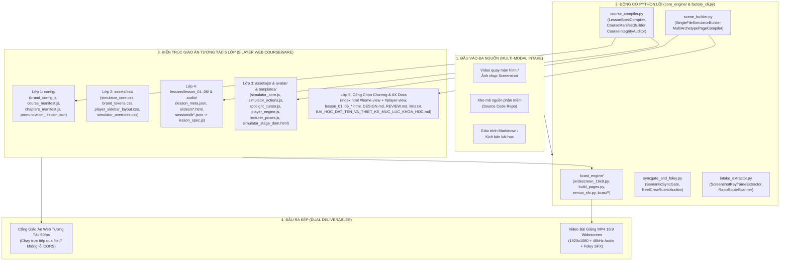
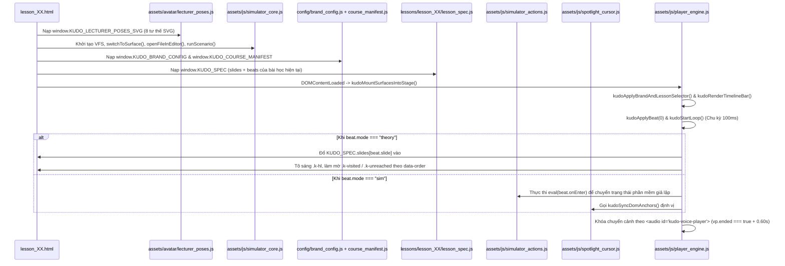

# Bản Đồ Mã Nguồn & Kiến Trúc Toàn Diện (`CODEMAP` v2.0): Nhà Máy Giáo Án Mô Phỏng Phần Mềm & Video Bài Giảng (`software-tutorial-video-factory`)

- **Mã tài liệu:** `CODEMAP-V2-SOFTWARE-TUTORIAL-VIDEO-FACTORY`
- **Cập nhật lần cuối:** `2026-11-05`
- **Mục đích:** Cung cấp bản đồ điều hướng chi tiết từng thư mục, tệp tin, class Python, hàm JavaScript, biến toàn cục `window.*` và luồng dữ liệu để bất kỳ AI Agent nào (Claude Code, Google Antigravity, Cursor) hoặc kỹ sư phần mềm khi mở repo đều nắm bắt được toàn bộ hệ thống trong 30 giây.

---

## 1. Sơ Đồ Kiến Trúc Tổng Thể 2 Nhánh Sản Xuất (High-Level Architecture)



---

## 2. Cây Thư Mục Toàn Hệ Thống (Repository Directory Map)

```text
software-tutorial-video-factory/
├── README.md                                       # Tài liệu hướng dẫn tổng quan & Quickstart cho AI Agent
├── AGENTS.md                                       # Quy tắc vận hành bắt buộc cho Google Antigravity / Codex
├── CLAUDE.md                                       # Quy tắc vận hành bắt buộc cho Claude Code
├── factory_cli.py                                  # Giao diện dòng lệnh hợp nhất (7 subcommands)
├── docs/
│   ├── SPEC_V2_5LAYER_COURSEWARE_ENGINE.md         # Đặc tả kỹ thuật chi tiết Kiến trúc Giáo án 5 Lớp (v2.0)
│   └── CODEMAP.md                                  # Bản đồ mã nguồn, bảng ký hiệu AST & luồng gọi hàm (file này)
├── core_engine/                                    # Tầng động cơ Python lõi (0 phụ thuộc ngoài lúc kiểm thử)
│   ├── __init__.py                                 # Xuất các class lõi của nhà máy
│   ├── intake_extractor.py                         # Bóc tách ảnh/video & quét cấu trúc repo mã nguồn
│   ├── course_compiler.py                          # Biên dịch giáo án 5 lớp (JSON/HTML -> JS không dính CORS) & kiểm toán
│   ├── scene_builder.py                            # Sinh trình mô phỏng HTML & kiểm tra hợp đồng neo kịch bản
│   ├── syncgate_and_foley.py                       # Chốt chặn nhịp/phụ đề tiếng Việt, âm thanh Foley 48kHz & chấm điểm
│   └── kcast_engine/                               # Động cơ quay màn hình Playwright CDP & kết xuất MP4 16:9 (/kudo)
│       ├── __init__.py
│       ├── widescreen_16x9.py                      # Đạo diễn quay 16:9 khớp mốc từ khóa lời đọc (LEAD_BY_DO)
│       ├── build_pages.py                          # Trình biên dịch 6 khuôn giao diện (concept, app, webchat, predict, board, workspace)
│       ├── remux_sfx.py                            # Ghép nhạc nền & tiếng động Foley ở khoảng lặng (-8dB khi có lời thoại)
│       ├── screencast.py                           # CLI quay màn hình cơ sở
│       ├── capture.js / stage.html / stage.js      # Môi trường sân khấu trình duyệt phục vụ ghi hình
│       ├── fonts/                                  # Bộ phông chữ nhúng sẵn (Be Vietnam Pro, Cormorant Garamond, IBM Plex Mono)
│       └── kcast/                                  # Các bước plan.py, capture.py, render.py, compose.py
├── examples/
│   ├── antigravity_studio_simulator/               # Mẫu chuẩn vàng 1: Hệ thống Giáo án Tương tác 5 Lớp Toàn Khóa (6 Chương · 24 Bài · 144 Phần nhỏ)
│   │   ├── index.html                              # Cổng mục lục 2 màn hình (6 Chương · 24 Bài giảng · 144 điểm neo, Single Left-Sidebar)
│   │   ├── lesson_01.html .. lesson_24.html        # 24 bài giảng chuẩn DAG (6 phần/bài: b1 Lý thuyết Kiểu 1, b2-b3 Lý thuyết Kiểu 2, b4-b6 Thực hành 3 bước)
│   │   ├── lesson_01_chatbot_vs_agent.html ..      # 6 tệp bí danh tương thích ngược (legacy aliases)
│   │   ├── Antigravity_Simulator_Studio.html       # Bản Studio giả lập tự do toàn màn hình
│   │   ├── DESIGN.md / REVIEW.md / llms.txt        # Quy chuẩn thiết kế, checklist WCAG 2.2 AA & chỉ mục AI
│   │   ├── BAO_CAO_AUDIT_DOC_LAP_5_NGUYEN_TAC_KHOA_HOC.md # Báo cáo kiểm toán độc lập 5 nguyên tắc sư phạm toàn khóa
│   │   ├── CURRICULUM_DAG_24_LESSONS_MATRIX.md     # Ma trận đồ thị tiên quyết DAG 24 bài học (0% trùng lặp)
│   │   ├── config/                                 # Lớp 1: brand_config.json/.js, course_manifest.json/.js, chapters_manifest.json/.js, pronunciation_lexicon.json
│   │   ├── assets/                                 # Lớp 2 & 3: css/, js/, avatar/, templates/
│   │   ├── lessons/                                # Lớp 4: lesson_01..24/ (lesson_meta.json, slides/*.html, sessions/*.json, lesson_spec.js)
│   │   └── audio/                                  # Tệp giọng giảng thực tế 48kHz (lesson_01..24/b1..b6.mp3 — 144 tệp MP3)
│   └── hanam_16x9_course/                          # Mẫu chuẩn vàng 2: Dây chuyền Video 16:9 Đa Khuôn (Khóa BIDV Hà Nam)
│       ├── scripts/                                # build_pages.py, run_kudo_16x9.py, remux_sfx.py
│       └── specs/                                  # B01_SaiLamThuongGap.json, B02_BaCapDoLamViecAI.json, BRIEF_AGY_VIET_SPEC.md
├── prompts/                                        # 4 mẫu Prompt chuyên biệt cho từng chặng sản xuất của AI Agent
├── .agents/skills/software-simulation-video-factory/ # Gói Skill chuẩn Antigravity (SKILL.md, references/, scripts/, templates/)
├── .claude/skills/software-simulation-video-factory/ # Gói Skill tương thích Claude Code
└── tests/
    └── test_factory_pipeline.py                    # Bộ kiểm thử tự động toàn trình (pytest)
```

---

## 3. Bản Đồ Ký Hiệu Mã Nguồn Python (`core_engine/` & `factory_cli.py`)

| Tệp mã nguồn | Class / Hàm chính | Nhiệm vụ & Đầu vào / Đầu ra |
| :--- | :--- | :--- |
| `core_engine/course_compiler.py` | `LessonSpecCompiler` | Biên dịch 1 thư mục bài học (`lessons/lesson_XX/`): ghép `lesson_meta.json` + `slides/*.html` + `sessions/*.json` thành `lesson_spec.js` (`window.KUDO_SPEC`) và tính tổng thời lượng. |
| `core_engine/course_compiler.py` | `CourseManifestBuilder` | Biên dịch toàn khóa học: duyệt tất cả `lessons/lesson_*`, sinh `config/course_manifest.json` & `.js` (`window.KUDO_COURSE_MANIFEST`) và đồng bộ `config/brand_config.js` (`window.KUDO_BRAND_CONFIG`). |
| `core_engine/course_compiler.py` | `CourseIntegrityAuditor` | Kiểm toán cơ học đủ 5 lớp kiến trúc, kiểm tra liên kết `slide` / `audio_src` và chặn đứng mọi tệp ngoại lai (`*audition*`). |
| `core_engine/intake_extractor.py` | `ScreenshotKeyframeExtractor` | Trích xuất khung hình tĩnh từ video quay màn hình (`.mp4`) và lập hồ sơ các vùng giao diện (`UI Surface Blueprint`). |
| `core_engine/intake_extractor.py` | `RepoRouteScanner` | Quét kho mã nguồn ứng dụng thực tế để trích xuất danh sách trang, component, màu sắc và dữ liệu mẫu phục vụ dựng giả lập. |
| `core_engine/scene_builder.py` | `SingleFileSimulatorBuilder` | Kiểm tra các thành phần bắt buộc của trình mô phỏng (`#laser-cursor`, `#custom-select-floating`, `VFS`, `glideLaserTo`) và kiểm tra độ sạch bối cảnh (`audit_context_purity`). |
| `core_engine/scene_builder.py` | `MultiArchetypePageCompiler` | Kiểm tra hợp đồng kịch bản JSON 6 khuôn giao diện, xác minh 100% chuỗi mỏ neo `at` trong `steps` và `beats` đều khớp với lời đọc `say`. |
| `core_engine/syncgate_and_foley.py` | `SemanticSyncGate` | Chốt chặn cơ học kiểm tra tốc độ đọc (âm tiết/giây), chia dòng tiếng Việt không cắt đôi từ ghép, và tổng hợp âm thanh Foley WAV 48kHz (`synthesize_procedural_foley_wav`). |
| `core_engine/syncgate_and_foley.py` | `ReelCrewRubricAuditor` | Chấm điểm chất lượng kịch bản và trình mô phỏng trên thang 100 điểm theo 5 tiêu chí sư phạm. |
| `factory_cli.py` | `main()` | Cung cấp 7 lệnh CLI: `intake-repo`, `compile-course`, `verify-course`, `validate-spec`, `audit-html`, `synth-foley`, `score-rubric`. |

---

## 4. Bản Đồ Kiến Trúc 5 Lớp Trình Phát Giáo Án Web (`examples/antigravity_studio_simulator/`)

### 4.1. Sơ Đồ Kết Nối Biến Toàn Cục & Luồng Điều Khiển (`JavaScript Runtime Wiring`)



### 4.2. Bảng Chi Tiết Các Tệp Trong 5 Lớp Giáo Án (`5-Layer File Inventory`)

| Lớp (Layer) | Đường dẫn tệp | Biến toàn cục / Hàm xuất ra | Vai trò trong Giáo án |
| :--- | :--- | :--- | :--- |
| **Lớp 1: Cấu hình (`config/`)** | `config/brand_config.json` & `.js` | `window.KUDO_BRAND_CONFIG` | Lưu tên khóa học, học viện, giảng viên, bảng màu thương hiệu Be Kem & Da Cam Nhấn (`#FAF8F5`, `#F4EFE6`, `#CB4B16`). |
| **Lớp 1: Cấu hình (`config/`)** | `config/course_manifest.json` & `.js` | `window.KUDO_COURSE_MANIFEST` | Danh mục 6 bài học (`BÀI 1`..`BÀI 6`), `short_title`, `pill_label`, số phần nhỏ (`beats_count`), thời lượng (`duration_formatted`). |
| **Lớp 1: Cấu hình (`config/`)** | `config/chapters_manifest.json` & `.js` | `window.KUDO_CHAPTERS_MANIFEST` | Lộ trình tổng thể 6 Chương · 42 Bài giảng phục vụ Trang chủ Chọn Chương (`#home-view` trên `index.html`). |
| **Lớp 1: Cấu hình (`config/`)** | `config/pronunciation_lexicon.json` | JSON cấu hình phát âm | Quy tắc giữ nguyên tiếng Anh gốc và đọc dấu chấm đuôi tệp (`.zip` $\to$ `Chấm zip`). |
| **Lớp 2: Giao diện (`assets/css/`)** | `assets/css/simulator_core.css` | CSS cho `#surface-mgr` & `#surface-ide` | Tái tạo giao diện Antigravity 2.0 (bảng màu `#E3DFD1`, `#CB4B16`) và Antigravity IDE 3 cột. |
| **Lớp 2: Giao diện (`assets/css/`)** | `assets/css/brand_tokens.css` | `:root` CSS Variables (`--kudo-*`) | Định nghĩa chiều rộng Sidebar (`315px`), chiều cao phụ đề (`68px`), tông màu Be Kem (`#FAF8F5`) và phông chữ. |
| **Lớp 2: Giao diện (`assets/css/`)** | `assets/css/player_sidebar_layout.css` | CSS Grid 2 cột & Responsive `@media` | Chia cột trái điều khiển (`#kudo-left-sidebar`, `315px`, 2 hàng nút gọn) và cột phải trình chiếu (`#kudo-right-main`), tự ẩn `.ksb-brand-bar` khi nhúng trong `iframe` (`body.in-iframe`). |
| **Lớp 2: Giao diện (`assets/css/`)** | `assets/css/simulator_overrides.css` | CSS cho `#kudo-spotlight` & `#kudo-cursor` | Định dạng hộp tiêu điểm màu cam, con trỏ chuột giả lập, nhãn gợi ý và các popover nổi. |
| **Lớp 3: Động cơ (`assets/js/`, `avatar/`, `templates/`)** | `assets/avatar/lecturer_poses.js` | `window.KUDO_LECTURER_POSES_SVG` | Chứa 8 tư thế SVG của giảng viên với cơ chế nhép môi 2 trạng thái êm (`.kudo-mouth-closed` / `.kudo-mouth-parted`). |
| **Lớp 3: Động cơ** | `assets/templates/simulator_stage_dom.html` | HTML Fragment chuẩn của Simulator | Khung DOM gốc của cả 2 bề mặt phần mềm (`#surface-mgr` và `#surface-ide`) để tái sử dụng cho mọi bài học. |
| **Lớp 3: Động cơ** | `assets/js/simulator_core.js` | `VFS`, `switchToSurface()`, `openFileInEditor()`, `runScenario()` | Toàn bộ logic hoạt động của phần mềm giả lập (hệ thống tệp ảo, đổi chế độ xem Markdown/CSV, mở Settings/Extensions). |
| **Lớp 3: Động cơ** | `assets/js/simulator_actions.js` | `kudoOpenModelPopover()`, `kudoOpenTurboPopover()`, `kudoRunGrillAndPlanDemo()`, `kudoRunLearnDemo()`, v.v. | Các hàm dàn dựng trạng thái phần mềm tương ứng với từng nhịp giảng giải trong bài học. |
| **Lớp 3: Động cơ** | `assets/js/spotlight_cursor.js` | `kudoSyncDomAnchors()` | Tính toán hộp tiêu điểm `#kudo-spotlight` và vị trí con trỏ `#kudo-cursor` kẹp trong `#kudo-stage-viewport`, chống đè lên bảng gợi ý. |
| **Lớp 3: Động cơ** | `assets/js/player_engine.js` | `kudoApplyBeat()`, `kudoStartLoop()`, `kudoTogglePlay()`, `kudoToggleMute()`, `kudoToggleCursorMode()` | Trái tim điều khiển bài giảng: đồng hồ chủ theo giọng đọc (`Audio-First Lock`), phím tắt `Space`/`←`/`→`/`M`/`C` và chuyển bài qua `postMessage`. |
| **Lớp 4: Nội dung (`lessons/`)** | `lessons/lesson_01..06/lesson_meta.json`, `slides/s*.html`, `sessions/b*.json` $\to$ `lesson_spec.js` | `window.KUDO_SPEC` | Nguồn dữ liệu biên tập từng bài học và tệp `.js` đã biên dịch để chạy trực tiếp qua `file://`. |
| **Lớp 5: Cổng vào (`*.html`)** | `index.html`, `lesson_01..06_*.html`, `DESIGN.md`, `REVIEW.md`, `llms.txt`, `BAI_HOC_DAT_TEN_VA_THIET_KE_MUC_LUC_KHOA_HOC.md` | Giao diện 2 màn hình (`#home-view` Chọn Chương + `#player-view` Trình phát) & tài liệu quy chuẩn | Cổng khóa học 6 Chương · 42 Bài giảng, 47 điểm neo đặt tên chuẩn sư phạm và chuẩn WCAG 2.2 AA. |

---

## 5. Quy Trình 4 Bước Để AI Agent Thêm Hoặc Sửa Bài Học Mới

1. **Bước 1 — Chỉnh sửa hoặc thêm hạt giáo án tại `lessons/lesson_XX/`:**
   - Thêm/sửa trang Slide lý thuyết tại `lessons/lesson_XX/slides/s1.html` (dùng class `.k-step-item` và `data-order="1..N"`).
   - Thêm/sửa nhịp giảng tại `lessons/lesson_XX/sessions/b1.json` (chọn `mode: "theory"` hoặc `mode: "sim"`).
   - Cập nhật danh sách `slide_ids` và `session_order` trong `lessons/lesson_XX/lesson_meta.json`.
2. **Bước 2 — Chạy Trình Biên Dịch Giáo Án 5 Lớp (`compile-course`):**
   ```bash
   python factory_cli.py compile-course --course-dir examples/antigravity_studio_simulator
   ```
   Lệnh này tự động cập nhật `lessons/lesson_XX/lesson_spec.js`, `config/course_manifest.json`, `config/course_manifest.js` và `config/brand_config.js`.
3. **Bước 3 — Kiểm Toán Tính Toàn Vẹn 5 Lớp (`verify-course`):**
   ```bash
   python factory_cli.py verify-course --course-dir examples/antigravity_studio_simulator
   ```
4. **Bước 4 — Chạy Kiểm Thử Toàn Nhà Máy (`pytest`):**
   ```bash
   pytest -q
   ```
