# Phase 1 — Đồ Thị Phụ Thuộc Sư Phạm (DAG), Ma Trận Khử Trùng Lặp & Đặc Tả Chi Tiết 24 Bài Giảng (6 Chương · 144 Điểm Neo)

## 1. Ma Trận Khử Trùng Lặp Toàn Khóa (`Global De-duplication Matrix`)

Khi rà soát tổng thể 42 đầu mục của bản nháp trước đây, có **7 cụm chủ đề bị trùng lặp từ 2 đến 3 lần** ở các chương khác nhau do cộng dồn cơ học từ nhiều buổi giảng. Dưới đây là bảng gom nhóm và phân bổ độc quyền về **24 Bài Giảng Tinh Hoa (6 Chương × 4 Bài/Chương)** đảm bảo **0% Duplicate / Overlap**:

| STT | Chủ đề bị lặp ở bản nháp cũ | Các vị trí từng bị lặp trước đây | Vị trí Độc quyền Chuẩn hóa trong 24 Bài mới | Lý do đặt tại vị trí mới |
| :--- | :--- | :--- | :--- | :--- |
| **1** | Giải nén `.zip`, `Open Folder`, đối chiếu `Reveal in File Explorer` & quy tắc không mở cả ổ `C:\` / không đổi tên thư mục đang làm | Rải rác ở `M02`, `M06` (cuối Chương 1) và `M12` (cuối Chương 2) | **Bài 2 (Chương 1)** | Học viên bắt buộc phải biết giải nén `.zip` và mở đúng thư mục dự án an toàn ngay trước khi chạm vào bất kỳ tệp tin nào. |
| **2** | Định dạng `.md`, `.csv`, số dòng `Line Numbers`, chế độ `Preview` & cài đặt tiện ích `Office Viewer` | Lặp lại ở `M02`, `M04`, `M07` và `M08` | **Bài 5 (Mở đầu Chương 2)** | Sau khi đã biết mở thư mục ở Chương 1, bài đầu tiên của Chương 2 giải quyết trọn vẹn cách đọc và hiển thị đẹp 2 định dạng cốt lõi `.md` và `.csv`. |
| **3** | Đính kèm tệp bằng `@`, nhập liệu giọng nói `Ctrl + M` & bôi đen trích dẫn `Ctrl + L` | Lặp lại ở `M01`, `M02`, `M09` và `M23` | **Bài 6 (Chương 2)** | Gom toàn bộ "3 kỹ năng giao việc nhanh trên khung chat" (`@`, `Ctrl+M`, `Ctrl+L`) vào 1 bài thực hành tập trung. |
| **4** | Hồ sơ cá nhân `@troly.md` & phân biệt bản chất `@` (vai trò) vs `/` (quy trình) | Nhắc nửa vời ở `M01`, `M02`, `M03` rồi lặp lại ở `M10` | **Bài 7 (Chương 2)** | Tuyệt đối không nhắc tới `@troly.md` ở Chương 1 khi học viên chưa biết tạo tệp; đến Bài 7 học viên tự tay tạo `troly.md` rồi mới gọi `@troly.md`. |
| **5** | Cấu trúc `.agent/` (`Rules`, `Skills`, `Workflows`) & ẩn dụ "Căn bếp" | Bị lặp nguyên xi giữa `M03` (Chương 1) và `M15`..`M20` (Chương 3) | **Bài 9, 10, 11 (Chương 3)** | Xóa bỏ hoàn toàn sự xuất hiện quá sớm ở Chương 1; dành trọn Chương 3 để đi sâu từng thành phần: `Rules` (Bài 9) $\to$ `Skills` (Bài 10) $\to$ `Workflows & /buildflow` (Bài 11). |
| **6** | Chu trình 3 lệnh `/grill-me` $\to$ `/plan` $\to$ `/learn` | Bị lặp tới 3 lần ở `M03` (Chương 1), `M15` (đầu Chương 3) và `M21` (cuối Chương 3) | **Bài 12 (Khép lại Chương 3)** | Khi học viên đã hiểu `Rules`, `Skills`, `Workflows` ở Bài 9–11, Bài 12 tổng kết Chương 3 bằng chu trình cộng tác 3 lệnh vàng `/grill-me -> /plan -> /learn`. |
| **7** | Duyệt web tự động `/browser`, nghiên cứu thị trường `/nctt` & đọc báo `VNExpress` | Rải rác ở `M23`, `M27`, `M34`, `M40` | **Bài 13 (Chương 4)** & **Bài 20 (Chương 5 — Tạo công cụ 0 tốn token)** | Bài 13 dạy nghiên cứu thị trường/VOC bằng `/browser`; Bài 20 nâng lên tầng viết công cụ Python lấy tin tự động 0 tốn hạn mức kết hợp hẹn giờ `Automations`. |

---

## 2. Sơ Đồ Đồ Thị Phụ Thuộc Sư Phạm (`Pedagogical Dependency DAG`)

```mermaid
flowchart TD
  subgraph CH1["CHƯƠNG 1: Khởi Động Chuẩn & Làm Chủ Giao Diện (Bài 1 - Bài 4)"]
    L01["Bài 1: Tư duy Trợ lý AI trên Máy tính & 2 Phần mềm"] --> L02["Bài 2: Giải nén .zip, Open Folder & An toàn Ổ cứng"]
    L02 --> L03["Bài 3: Giao diện 3 Cột, Phím Cứu hộ & Khi AI Dừng chờ"]
    L03 --> L04["Bài 4: Quyền Tự chủ Turbo & Thực hành Đầu tiên /start-1-1"]
  end

  subgraph CH2["CHƯƠNG 2: Định Dạng .md/.csv, Ký Hiệu @ & Hồ Sơ Cá Nhân (Bài 5 - Bài 8)"]
    L04 --> L05["Bài 5: Định dạng .md, .csv & Tiện ích Office Viewer"]
    L05 --> L06["Bài 6: Đính kèm @, Giọng nói Ctrl+M & Trích dẫn Ctrl+L"]
    L06 --> L07["Bài 7: Tạo Hồ sơ @troly.md & Ban bệ Nhân sự Ảo"]
    L07 --> L08["Bài 8: Bàn giao Ca ban_giao_cong_viec.md & Google Drive"]
  end

  subgraph CH3["CHƯƠNG 3: Bộ Não .agent (Rules, Skills, Workflows) & Cộng Tác (Bài 9 - Bài 12)"]
    L08 --> L09["Bài 9: Kiến trúc .agent & Thiết lập Nội quy Rules"]
    L09 --> L10["Bài 10: Giải phẫu Skills (viet-chuyen-nghiep) & Marketplace"]
    L10 --> L11["Bài 11: Biểu mẫu Templates, Workflows (/) & /buildflow"]
    L11 --> L12["Bài 12: Chu trình 3 Lệnh Vàng: /grill-me, /plan & /learn"]
  end

  subgraph CH4["CHƯƠNG 4: Ứng Dụng Văn Phòng Thực Chiến (Bài 13 - Bài 16)"]
    L12 --> L13["Bài 13: Nghiên cứu Thị trường & Đối thủ với /browser"]
    L13 --> L14["Bài 14: Phân tích Bảng tính @sales_data.csv & Báo cáo 1 Trang"]
    L14 --> L15["Bài 15: Nhân bản Giọng văn, Vẽ Ảnh & Dựng Trang Giới thiệu"]
    L15 --> L16["Bài 16: Thiết kế Slide Thuyết trình (.pptx & Google Slides)"]
  end

  subgraph CH5["CHƯƠNG 5: Tự Động Hóa Chuyên Sâu & Quản Trị Hệ Thống (Bài 17 - Bài 20)"]
    L16 --> L17["Bài 17: Kho Tài liệu P.A.R.A & Chống Bịa Số liệu"]
    L17 --> L18["Bài 18: Phối hợp Đa Trợ lý (/teamwork & /goal)"]
    L18 --> L19["Bài 19: Chuẩn hóa Word (NĐ 30) & 7 Quy tắc Excel"]
    L19 --> L20["Bài 20: Hẹn giờ Automations & Công cụ Chạy 0 Tốn Token"]
  end

  subgraph CH6["CHƯƠNG 6: 4 Tình Huống Đa Ngành, Bảo Mật & Điều Khiển Từ Xa (Bài 21 - Bài 24)"]
    L20 --> L21["Bài 21: Tình huống Chiến lược — Nhân bản Quy trình 7 Bước"]
    L21 --> L22["Bài 22: Tình huống HR & Pháp chế — 120 Hồ sơ UV_001 & Hợp đồng"]
    L22 --> L23["Bài 23: Tình huống Đa định dạng — Bản tin Vàng, Nội thất & Stitch"]
    L23 --> L24["Bài 24: Bảo vệ Bí kíp (.gitignore) & Điều khiển qua Điện thoại"]
  end
```

---

## 3. Phân Tích Chi Tiết Dependencies, Rủi Ro Vị Trí & Cấu Trúc 6 Điểm Neo (`1-2-3`) Cho Từng Bài Giảng

### CHƯƠNG 1: KHỞI ĐỘNG CHUẨN & LÀM CHỦ GIAO DIỆN (`Bài 1` $\to$ `Bài 4`)

#### Bài 1 (`lesson_01`): Tư Duy Trợ Lý AI Trên Máy Tính & Hai Phần Mềm Cốt Lõi
- **Kiến thức tiên quyết (`Prerequisites`):** Không (Bài nhập môn đầu tiên của khóa học).
- **Kiến thức kế thừa (`Dependents`):** Mở đường cho Bài 2 (Mở thư mục dự án trên `Antigravity IDE`) và Bài 4 (Cấu hình quyền trong `Antigravity 2.0`).
- **Đánh giá rủi ro vị trí (`Placement Risk`):** Rủi ro bằng 0 khi tuân thủ quy tắc **không nhét câu lệnh `@troly.md` hay `/plan` vào cuối Bài 1**. Ở Bài 1 chỉ dừng ở việc hiểu sự khác biệt giữa hỏi đáp trên web với trợ lý trong thư mục, phân biệt 2 phần mềm (`Antigravity 2.0` vs `Antigravity IDE`), chọn 5 mô hình AI và bấm nút `Open IDE`.
- **Tính tiếp nối (`Continuity Bridge`):** Cuối Bài 1, học viên vừa bấm `Open IDE` mở ra cửa sổ `Antigravity IDE` trống $\implies$ Tự nhiên đặt câu hỏi: *"Làm sao đưa bộ tài liệu khóa học vào cửa sổ này?"* $\implies$ Dẫn thẳng sang **Bài 2 (Giải nén `.zip` & Mở thư mục)**.
- **6 Điểm neo thời gian (`b1`..`b6`):**
  1. `b1` *(Lý thuyết Kiểu 1 - Slide Sơ đồ đối chiếu SVG + Quote)*: Chat trên trình duyệt web khác gì Trợ lý AI làm việc trong thư mục máy tính?
  2. `b2` *(Lý thuyết Kiểu 2 - Màn hình Antigravity 2.0)*: Giao diện phần mềm **Antigravity 2.0** (Trung tâm điều phối đa dự án) và vai trò của **Antigravity IDE**.
  3. `b3` *(Lý thuyết Kiểu 2 - Bảng chọn 5 Mô hình trên màn hình)*: Quy tắc chọn 5 mô hình AI (`Flash`, `Argon`, `Sonnet`, `Opus`, `GPT-OSS`) theo độ khó công việc & cơ chế hồi hạn mức (5 tiếng vs 5 ngày).
  4. `b4` *(Thực hành Bước 1 - Có bối cảnh)*: Bối cảnh bắt đầu ca làm việc $\to$ Mở bảng chọn mô hình trên `Antigravity 2.0` và chọn `Gemini 4 Argon Medium`.
  5. `b5` *(Thực hành Bước 2)*: Bấm nút `Open IDE` ở góc trên bên phải để mở sang không gian làm việc 3 cột `Antigravity IDE`.
  6. `b6` *(Thực hành Bước 3 & Nghiệm thu)*: Quan sát tổng thể cửa sổ `Antigravity IDE` vừa mở và chuẩn bị đưa thư mục học liệu vào máy ở Bài 2.

#### Bài 2 (`lesson_02`): Chuẩn Bị Học Liệu: Giải Nén `.zip`, Mở Thư Mục & An Toàn Ổ Cứng
- **Kiến thức tiên quyết (`Prerequisites`):** Bài 1 (Đã mở được cửa sổ `Antigravity IDE`).
- **Kiến thức kế thừa (`Dependents`):** Toàn bộ Bài 3 – Bài 24 đều thao tác trên thư mục `antigravity_course_vn` và bối cảnh công ty mẫu `TaskFlow Inc.` được mở tại bài này.
- **Đánh giá rủi ro vị trí (`Placement Risk`):** Đặt ở Bài 2 là **vị trí tối ưu nhất**. Nếu đặt muộn hơn (như Bài 6 cũ), học viên sẽ mở trực tiếp tệp trong cửa sổ nén `.zip` hoặc chọn nhầm cả ổ `C:\` làm treo máy ngay từ đầu.
- **Tính tiếp nối (`Continuity Bridge`):** Nối tiếp cú bấm `Open IDE` ở cuối Bài 1 $\to$ Giải nén học liệu $\to$ Mở thư mục `antigravity_course_vn` $\to$ Đọc `INDEX.md` làm quen công ty mẫu `TaskFlow Inc.` $\to$ Mở đường sang **Bài 3 (Làm chủ giao diện 3 cột vừa hiện ra)**.
- **6 Điểm neo thời gian (`b1`..`b6`):**
  1. `b1` *(Lý thuyết Kiểu 1 - Slide Sơ đồ luồng SVG + 3 Thẻ Cảnh báo)*: Ba nguyên tắc an toàn ổ cứng: Giải nén `.zip` trước khi mở, không mở cả ổ `C:\`, và không đổi tên thư mục khi đang làm dở.
  2. `b2` *(Lý thuyết Kiểu 2 - Màn hình IDE & Hộp thoại cảnh báo)*: Cơ chế đồng bộ 1-1 với ổ cứng máy tính và cách bấm `Cancel` khi lỡ tay kéo thả nhầm thư mục trên cột trái.
  3. `b3` *(Lý thuyết Kiểu 2 - Màn hình IDE mở `INDEX.md`)*: Giới thiệu bản đồ học liệu `INDEX.md` và bối cảnh công ty giả lập **`TaskFlow Inc.`** (45 nhân sự: CEO Alex, HR Sarah, Sales Mike).
  4. `b4` *(Thực hành Bước 1 - Có bối cảnh)*: Bối cảnh vừa tải gói học liệu `.zip` về máy $\to$ Giải nén ra thư mục thường và vào `File -> Open Folder` chọn mở `antigravity_course_vn`.
  5. `b5` *(Thực hành Bước 2)*: Nhấp chuột phải vào tệp `INDEX.md` trên cây thư mục chọn `Reveal in File Explorer` để kiểm chứng tệp thật trên ổ cứng Windows.
  6. `b6` *(Thực hành Bước 3 & Nghiệm thu)*: Bấm mở tệp `INDEX.md` ở cột giữa để xem toàn bộ lộ trình thực hành cùng đội ngũ `TaskFlow`.

#### Bài 3 (`lesson_03`): Làm Chủ Giao Diện 3 Cột, Phím Cứu Hộ & Xử Lý Khi AI Dừng Chờ
- **Kiến thức tiên quyết (`Prerequisites`):** Bài 2 (Cây thư mục dự án đã hiển thị trên cột trái của IDE).
- **Kiến thức kế thừa (`Dependents`):** Bài 4 (Khi chạy bài thực hành `/start-1-1`, học viên đã biết cách điều khiển 3 cột và xử lý khi AI dừng chờ).
- **Đánh giá rủi ro vị trí (`Placement Risk`):** Rủi ro bằng 0. Đặt ngay trước bài thực hành đầu tiên giúp giải tỏa 100% nỗi sợ "bấm nhầm mất khung hình" của dân văn phòng.
- **Tính tiếp nối (`Continuity Bridge`):** Sau khi mở thư mục ở Bài 2, màn hình hiện đủ 3 cột $\to$ Bài 3 hướng dẫn cách làm chủ 3 cột đó và các nút điều khiển $\to$ Sẵn sàng chạy bài tập đầu tiên ở **Bài 4**.
- **6 Điểm neo thời gian (`b1`..`b6`):**
  1. `b1` *(Lý thuyết Kiểu 1 - Slide Sơ đồ 3 cột + Timeline tâm lý)*: Giải phẫu bàn làm việc 3 cột và nguyên tắc vàng: *"Quên thao tác nào, hỏi trực tiếp Trợ lý AI bằng tiếng Việt ngay trong khung chat"*.
  2. `b2` *(Lý thuyết Kiểu 2 - Màn hình IDE 3 cột)*: Ý nghĩa cột số dòng (`Line Numbers 1, 2, 3...`) như "tọa độ GPS" giữa người với AI, cùng tổ hợp phím cứu hộ `Ctrl + B` (ẩn/hiện cột trái) và `Ctrl + Alt + B` (ẩn/hiện cột phải).
  3. `b3` *(Lý thuyết Kiểu 2 - Màn hình Khung Chat)*: Ba tình huống AI dừng chờ hay gặp nhất và cách xử lý: bấm `Stop` (`■`) khi làm lệch ý, gõ `"Tiếp tục"` khi ngắt quãng, bấm `Accept` khi chờ cấp quyền.
  4. `b4` *(Thực hành Bước 1 - Có bối cảnh)*: Bối cảnh lỡ tay làm ẩn mất cây thư mục bên trái $\to$ Nhấn tổ hợp phím `Ctrl + B` để khôi phục ngay cột cây thư mục.
  5. `b5` *(Thực hành Bước 2)*: Quan sát thanh trạng thái khi AI đang chạy và thực hành thao tác với cụm nút `Stop` / `Tiếp tục` / `Accept`.
  6. `b6` *(Thực hành Bước 3 & Nghiệm thu)*: Gõ câu hỏi tiếng Việt tự nhiên vào khung chat (*"Chỉ cho tôi cách đổi giao diện sáng tối và xem tài liệu dễ đọc"*) và nghiệm thu câu trả lời tận tình của AI.

#### Bài 4 (`lesson_04`): Bật Quyền Tự Chủ `Turbo` & Bài Thực Hành Đầu Tiên Với `/start-1-1`
- **Kiến thức tiên quyết (`Prerequisites`):** Bài 2 (Biết bối cảnh `TaskFlow`) & Bài 3 (Biết giao diện 3 cột và nút `Accept`).
- **Kiến thức kế thừa (`Dependents`):** Khép lại trọn vẹn Chương 1, tạo đà tâm lý hứng khởi để bước sang Chương 2 làm việc với dữ liệu `.md`, `.csv` và `@`.
- **Đánh giá rủi ro vị trí (`Placement Risk`):** Rất an toàn và hợp lý. Ở Bài 3 học viên vừa thấy cảnh phải bấm `Accept` thủ công $\to$ Sang đầu Bài 4 học cách bật `Turbo` để AI tự chạy mượt mà, rồi gõ ngay lệnh thực hành đầu tiên `/start-1-1`.
- **Tính tiếp nối (`Continuity Bridge`):** Từ việc phải bấm `Accept` ở Bài 3 $\to$ Bật `Turbo` ở đầu Bài 4 $\to$ Chạy thành công bài thực hành nhập môn `/start-1-1` $\to$ Chuyển sang **Chương 2 (Làm chủ tệp `.md`, `.csv` và `@`)**.
- **6 Điểm neo thời gian (`b1`..`b6`):**
  1. `b1` *(Lý thuyết Kiểu 1 - Slide Biểu đồ 4 cấp độ quyền tự chủ)*: So sánh 4 mức cấp quyền (`Request Review`, `Default`, `Auto`, `Turbo`) — vì sao khi học trên thư mục mẫu nên bật `Turbo`?
  2. `b2` *(Lý thuyết Kiểu 2 - Màn hình Settings của Antigravity 2.0)*: Vị trí mục `Settings -> General -> This Computer -> Turbo` trên cửa sổ `Antigravity 2.0`.
  3. `b3` *(Lý thuyết Kiểu 2 - Màn hình IDE & Bảng gợi ý lệnh `/start-1-1`)*: Cách gọi quy trình bằng dấu gạch chéo `/` và lưu ý tránh "bẫy phím Cách (`Space`)" hoặc gõ lặp thành `/start-1-1-1`.
  4. `b4` *(Thực hành Bước 1 - Có bối cảnh)*: Bối cảnh chuẩn bị làm bài tập đầu tiên không bị gián đoạn $\to$ Mở `Settings` trên `Antigravity 2.0` và chuyển quyền tự chủ sang mức `Turbo`.
  5. `b5` *(Thực hành Bước 2)*: Quay lại cửa sổ `Antigravity IDE`, mở tệp `1.1_Welcome.md` ở cột giữa và gõ `/start` vào khung chat để bật bảng gợi ý lệnh.
  6. `b6` *(Thực hành Bước 3 & Nghiệm thu)*: Bấm chọn `/start-1-1` từ bảng gợi ý, nhấn `Enter` và trải nghiệm cảm giác Trợ lý AI đóng vai người hướng dẫn dẫn dắt từng bước tại `TaskFlow Inc.`.

---

### CHƯƠNG 2: ĐỊNH DẠNG DỮ LIỆU `.MD`/`.CSV`, KÝ HIỆU `@` & HỒ SƠ CÁ NHÂN HÓA (`Bài 5` $\to$ `Bài 8`)

#### Bài 5 (`lesson_05`): Định Dạng Văn Bản `.md`, Bảng Dữ Liệu `.csv` & Tiện Ích `Office Viewer`
- **Kiến thức tiên quyết (`Prerequisites`):** Chương 1 (Đã biết mở thư mục và chọn tệp trên cây thư mục).
- **Kiến thức kế thừa (`Dependents`):** Bài 6 (Đính kèm `@COMPANY.md`, `@sales_data.csv`), Bài 7 (Tạo `@troly.md`), Bài 14 (Phân tích `@sales_data.csv`).
- **Đánh giá rủi ro vị trí (`Placement Risk`):** Rủi ro bằng 0. Học viên hiểu rõ chất liệu tệp `.md` và `.csv` trước khi dùng dấu `@` để đính kèm chúng ở Bài 6.
- **Tính tiếp nối (`Continuity Bridge`):** Trong bài `/start-1-1` ở cuối Chương 1, học viên đã thấy các tệp đuôi `.md` và `.csv` $\to$ Bài 5 giải thích tại sao AI thích 2 định dạng này và cách xem chúng đẹp như Word/Excel.
- **6 Điểm neo thời gian (`b1`..`b6`):**
  1. `b1` *(Lý thuyết Kiểu 1 - Slide Biểu đồ tốc độ đọc & So sánh Extension vs Skill)*: Tại sao `.md` và `.csv` là "ngôn ngữ mẹ đẻ" siêu nhẹ của AI? Phân biệt rõ **Extension** (tiện ích hiển thị cho mắt người) và **Skill** (kỹ năng xử lý của AI).
  2. `b2` *(Lý thuyết Kiểu 2 - Màn hình IDE mở tệp `.md`)*: Ba ký hiệu Markdown cơ bản (`#` tiêu đề, `**in đậm**`, `-` danh sách), chế độ đọc đẹp `Preview` (`Ctrl + Shift + V`) và mẹo `Paste from Markdown` sang Google Docs.
  3. `b3` *(Lý thuyết Kiểu 2 - Màn hình Extensions & Bảng `.csv`)*: Cách kiểm tra lượt tải an toàn khi cài tiện ích `Office Viewer` (`Ctrl + Shift + X`) để hiển thị tệp `.csv` thành bảng kẻ ô trực quan.
  4. `b4` *(Thực hành Bước 1 - Có bối cảnh)*: Bối cảnh đọc hồ sơ công ty `TaskFlow` $\to$ Bấm mở tệp `COMPANY.md` trên cây thư mục và chuyển sang chế độ xem trực quan `Preview`.
  5. `b5` *(Thực hành Bước 2)*: Bấm mở tệp `sales_data.csv` ở cột trái để quan sát dữ liệu doanh thu hiển thị dưới dạng bảng tính có hàng cột rõ ràng nhờ `Office Viewer`.
  6. `b6` *(Thực hành Bước 3 & Nghiệm thu)*: Đối chiếu cấu trúc các cột dữ liệu (`Product`, `Revenue`, `Cost`, `Profit`) trong `sales_data.csv`, sẵn sàng giao việc cho AI ở Bài 6.

#### Bài 6 (`lesson_06`): Đính Kèm Tệp Bằng `@`, Giao Việc Giọng Nói (`Ctrl + M`) & Trích Dẫn (`Ctrl + L`)
- **Kiến thức tiên quyết (`Prerequisites`):** Bài 5 (Đã nắm rõ nội dung tệp `COMPANY.md` và `sales_data.csv`).
- **Kiến thức kế thừa (`Dependents`):** Bài 7 (Dùng `@` để gọi nhân sự ảo `@troly.md`) và toàn bộ các bài thực hành sau.
- **Đánh giá rủi ro vị trí (`Placement Risk`):** Rủi ro bằng 0. Chỉ dùng đúng 2 tệp học viên đã mở ở Bài 5 (`@COMPANY.md` và `@sales_data.csv`), tuyệt đối không dùng tệp lạ chưa học.
- **Tính tiếp nối (`Continuity Bridge`):** Đã xem mắt thường 2 tệp ở Bài 5 $\to$ Sang Bài 6 dùng `@`, `Ctrl + M` và `Ctrl + L` để chỉ điểm cho AI đọc và sửa đúng 2 tệp đó.
- **6 Điểm neo thời gian (`b1`..`b6`):**
  1. `b1` *(Lý thuyết Kiểu 1 - Slide Sơ đồ 3 Phương thức Giao việc tốc độ cao)*: Ba vũ khí giúp dân văn phòng giao việc nhanh gấp 5 lần: Đính kèm chính xác bằng `@`, đọc giọng nói `Ctrl + M`, và trích dẫn đoạn văn `Ctrl + L`.
  2. `b2` *(Lý thuyết Kiểu 2 - Màn hình Khung Chat & Popup `@`)*: Cơ chế hoạt động của ký hiệu `@` (nạp thẳng nội dung tệp vào bộ nhớ của AI mà không cần sao chép thủ công) và lưu ý bộ gõ tiếng Việt.
  3. `b3` *(Lý thuyết Kiểu 2 - Màn hình Thu âm `Ctrl + M` & Nút `Quote in Chat`)*: Cách bấm `Ctrl + M` nói chuyện tự nhiên tối đa 2 phút/lần và cách bôi đen dòng văn bản bấm `Ctrl + L` để yêu cầu sửa đúng vị trí.
  4. `b4` *(Thực hành Bước 1 - Có bối cảnh)*: Bối cảnh cần tổng hợp nhanh thông tin `TaskFlow` $\to$ Gõ ký hiệu `@` trong khung chat và chọn đính kèm `@COMPANY.md` cùng `@sales_data.csv`.
  5. `b5` *(Thực hành Bước 2)*: Nhấn tổ hợp `Ctrl + M` bật thu âm giọng nói để giao yêu cầu tóm tắt tình hình kinh doanh bằng lời nói tự nhiên.
  6. `b6` *(Thực hành Bước 3 & Nghiệm thu)*: Bôi đen một nhận định trong văn bản ở cột giữa, nhấn `Ctrl + L` (`Quote in Chat`) để trích dẫn sang khung chat và yêu cầu AI bổ sung số liệu chi tiết.

#### Bài 7 (`lesson_07`): Tạo Hồ Sơ Trợ Lý Cá Nhân `@troly.md` & Xây Dựng Ban Bệ Nhân Sự Ảo
- **Kiến thức tiên quyết (`Prerequisites`):** Bài 5 (Biết tệp `.md`) & Bài 6 (Biết đính kèm bằng `@`).
- **Kiến thức kế thừa (`Dependents`):** Bài 8 (Bàn giao ca) & Chương 3 (Nâng cấp từ tệp `@troly.md` đơn lẻ lên thư mục `.agent/rules`).
- **Đánh giá rủi ro vị trí (`Placement Risk`):** Đặt ở Bài 7 giải quyết triệt để lỗi "cầm đèn chạy trước ô tô" trước đây: học viên được hướng dẫn **tự tay tạo tệp `troly.md`** rồi mới gõ `@troly.md` trong câu lệnh!
- **Tính tiếp nối (`Continuity Bridge`):** Ở Bài 6 học viên thấy `@` đính kèm được tệp dữ liệu $\to$ Bài 7 nâng lên một tầm mới: nếu tệp `.md` đó mô tả tính cách và nhiệm vụ của một trợ lý, thì gõ `@troly.md` chính là triệu tập một nhân viên ảo!
- **6 Điểm neo thời gian (`b1`..`b6`):**
  1. `b1` *(Lý thuyết Kiểu 1 - Slide Sơ đồ Phòng ban Ảo & Chuyển nhà từ Cloud về Máy)*: Tư duy biến tệp `.md` thành đội ngũ nhân sự chuyên trách (`@troly.md`, `@ke_toan.md`, `@hr.md`) và cách xuất toàn bộ ký ức từ ChatGPT về máy tính.
  2. `b2` *(Lý thuyết Kiểu 2 - Màn hình IDE so sánh `@` và `/`)*: Màn thực nghiệm phân biệt rõ bản chất giữa **`@` (Đính kèm hồ sơ nhân vật — giữ nguyên tâm thế)** và **`/` (Gọi quy trình mệnh lệnh — chuyển sang nhiệm vụ mới)**.
  3. `b3` *(Lý thuyết Kiểu 2 - Màn hình soạn thảo `troly.md`)*: Cấu trúc 3 phần viết bằng văn xuôi tự nhiên trong tệp `troly.md`: (1) Vai trò & Xưng hô, (2) Phong cách trình bày ngắn gọn, (3) Hai câu hỏi đề xuất cuối mỗi câu trả lời.
  4. `b4` *(Thực hành Bước 1 - Có bối cảnh)*: Bối cảnh tạo trợ lý riêng cho Giám đốc Vận hành $\to$ Tạo tệp `troly.md` trong thư mục dự án, viết 3 nguyên tắc làm việc và bấm `Ctrl + S` lưu lại.
  5. `b5` *(Thực hành Bước 2)*: Mở khung chat, gõ `@troly.md` kết hợp `@sales_data.csv` và yêu cầu lập báo cáo doanh thu Quý 1.
  6. `b6` *(Thực hành Bước 3 & Nghiệm thu)*: Nghiệm thu kết quả: AI lập tức xưng hô đúng chuẩn, trình bày báo cáo súc tích và chủ động gợi ý 2 bước hành động tiếp theo đúng như trong `troly.md`.

#### Bài 8 (`lesson_08`): Quản Trị Hội Thoại Dài: Tệp Bàn Giao Ca `ban_giao_cong_viec.md`, `/compact` & Google Drive
- **Kiến thức tiên quyết (`Prerequisites`):** Bài 7 (Đã hiểu cách lưu ngữ cảnh vào tệp `.md` và gọi lại bằng `@`).
- **Kiến thức kế thừa (`Dependents`):** Chương 3 (Đóng gói các quy tắc và quy trình lặp lại vào thư mục `.agent/`).
- **Đánh giá rủi ro vị trí (`Placement Risk`):** Rủi ro bằng 0. Đặt ở cuối Chương 2 giúp học viên biết cách giữ cho không gian làm việc luôn gọn nhẹ, không bị tràn bộ nhớ khi làm việc qua nhiều ngày.
- **Tính tiếp nối (`Continuity Bridge`):** Sau khi làm việc hăng say với `@troly.md` ở Bài 7, cuộc hội thoại sẽ dài ra $\to$ Bài 8 dạy cách nén gọn bằng `/compact` hoặc đóng gói thành tệp `ban_giao_cong_viec.md` để chuyển sang phiên chat mới trong 3 giây.
- **6 Điểm neo thời gian (`b1`..`b6`):**
  1. `b1` *(Lý thuyết Kiểu 1 - Slide Biểu đồ Suy giảm Tập trung & Sơ đồ Bàn giao ca)*: Tại sao cuộc chat quá dài làm AI tốn hạn mức và giảm độ chính xác? Nguyên lý "Bàn giao ca làm việc qua tệp `ban_giao_cong_viec.md`" và đồng bộ dự án qua Google Drive.
  2. `b2` *(Lý thuyết Kiểu 2 - Màn hình Lịch sử Chat `Ctrl + K` & `/compact`)*: Cách bấm `Ctrl + K` tìm lại hội thoại cũ, dùng lệnh `/compact` tóm tắt bộ nhớ, và nguyên lý *"Xóa đoạn chat nháp không bao giờ làm mất tệp sản phẩm trên ổ cứng"*.
  3. `b3` *(Lý thuyết Kiểu 2 - Màn hình tệp `ban_giao_cong_viec.md`)*: Cấu trúc chuẩn của một tệp bàn giao ca: Mục tiêu dự án, Các việc đã hoàn thành, Các tệp quan trọng, và Việc cần làm tiếp theo.
  4. `b4` *(Thực hành Bước 1 - Có bối cảnh)*: Bối cảnh kết thúc ca làm việc chiều thứ Sáu $\to$ Giao lệnh cho AI tổng hợp toàn bộ tiến độ đang làm dở ra tệp `ban_giao_cong_viec.md`.
  5. `b5` *(Thực hành Bước 2)*: Mở một phiên hội thoại mới tinh và chỉ cần gõ `@ban_giao_cong_viec.md` để trợ lý kế nhiệm nắm bắt 100% mạch công việc trong 3 giây.
  6. `b6` *(Thực hành Bước 3 & Nghiệm thu)*: Yêu cầu AI quét thư mục dự án để cập nhật danh mục liên kết nhanh vào tệp bản đồ `INDEX.md`.

---

### CHƯƠNG 3: THIẾT LẬP BỘ NÃO `.AGENT/` (`RULES`, `SKILLS`, `WORKFLOWS`) & CHU TRÌNH CỘNG TÁC (`Bài 9` $\to$ `Bài 12`)

#### Bài 9 (`lesson_09`): Kiến Trúc Bộ Ba `.agent/` (`Rules`, `Skills`, `Workflows`) & Thiết Lập Nội Quy `Rules`
- **Kiến thức tiên quyết (`Prerequisites`):** Chương 2 (Đã biết dùng `@troly.md`, hiểu nhu cầu cần một cơ chế tự động áp dụng quy tắc mà không phải gõ `@` mỗi lần).
- **Kiến thức kế thừa (`Dependents`):** Bài 10 (`Skills`), Bài 11 (`Workflows`), Bài 12 (`/learn` cập nhật vào `Rules`) và Bài 22 (Quy tắc ẩn danh `UV_001`).
- **Đánh giá rủi ro vị trí (`Placement Risk`):** Đặt ở mở đầu Chương 3 là chuẩn xác tuyệt đối (thay vì đẩy nhầm lên Bài 3 của Chương 1 như trước đây). Lúc này học viên đã thành thạo thao tác cơ bản nên tiếp thu khái niệm `.agent/` rất nhẹ nhàng.
- **Tính tiếp nối (`Continuity Bridge`):** Ở Chương 2, mỗi lần muốn AI nhớ quy tắc ta phải gõ `@troly.md` thủ công $\to$ Sang Bài 9 (Chương 3), ta đưa quy tắc đó vào `.agent/rules/` để AI **tự động nhớ 100% mọi lúc** mà không cần nhắc!
- **6 Điểm neo thời gian (`b1`..`b6`):**
  1. `b1` *(Lý thuyết Kiểu 1 - Slide Ẩn dụ Căn Bếp Nhà Hàng 3 Ngăn SVG)*: Phân biệt trực quan 3 thành phần trong `.agent/`: **`Rules` (Nội quy dán trên tường luôn bật)**, **`Skills` (Sổ công thức chuyên môn khi cần mới mở)**, **`Workflows` (Dây chuyền từng bước gọi bằng dấu `/`)**.
  2. `b2` *(Lý thuyết Kiểu 2 - Màn hình Customizations Global vs Workspace)*: Mở bảng `Customizations` phân biệt quy tắc cấp **`Global` (áp dụng cho mọi dự án trên máy)** vs **`Workspace` (chỉ áp dụng cho thư mục hiện tại)** và cách dọn mục `Knowledge`.
  3. `b3` *(Lý thuyết Kiểu 2 - Màn hình `.agent/rules/noi_quy_chung.md`)*: Quy tắc viết tệp `Rules` hiệu quả: ngắn gọn dưới 50 dòng (chống ngộ độc bối cảnh) và tích hợp quy tắc bảo mật ẩn danh hồ sơ nhân sự (`UV_001`).
  4. `b4` *(Thực hành Bước 1 - Có bối cảnh)*: Bối cảnh thiết lập kỷ luật đầu ra và bảo mật cho dự án `TaskFlow` $\to$ Mở cây thư mục `.agent/rules/` trên cột trái của IDE.
  5. `b5` *(Thực hành Bước 2)*: Mở và chuẩn hóa tệp `noi_quy_chung.md` với 3 quy định: trả lời tiếng Việt rõ ràng, nghiệm thu bằng tệp thật trên ổ cứng, và mã hóa tên ứng viên thành `UV_001`.
  6. `b6` *(Thực hành Bước 3 & Nghiệm thu)*: Giao thử một câu hỏi kiểm tra trên khung chat (không cần gõ `@`) và nghiệm thu việc AI tự động áp dụng đúng nội quy trong `.agent/rules/`.

#### Bài 10 (`lesson_10`): Giải Phẫu `Skills` Chuyên Môn (`viet-chuyen-nghiep`), Kho `skills.sh` & `Marketplace`
- **Kiến thức tiên quyết (`Prerequisites`):** Bài 9 (Đã hiểu bức tranh 3 thành phần `.agent/` và `Rules`).
- **Kiến thức kế thừa (`Dependents`):** Bài 11 (`Workflows` gọi `Skills`), Chương 4 (Kỹ năng viết bài, làm slide) & Chương 5 (Kỹ năng xử lý Word/Excel).
- **Đánh giá rủi ro vị trí (`Placement Risk`):** Rủi ro bằng 0. Học xong `Rules` (luôn bật) ở Bài 9 thì sang Bài 10 học `Skills` (chuyên môn sâu chỉ nạp khi đúng việc) tạo sự đối chiếu rõ rệt.
- **Tính tiếp nối (`Continuity Bridge`):** Nếu nhét hàng trăm trang hướng dẫn viết báo, làm Excel vào `Rules` thì AI sẽ bị quá tải bộ nhớ $\to$ Giải pháp chính là đóng gói chúng thành các hộp kỹ năng `Skills` ở Bài 10!
- **6 Điểm neo thời gian (`b1`..`b6`):**
  1. `b1` *(Lý thuyết Kiểu 1 - Slide Sơ đồ Cấu trúc Hộp Kỹ Năng & Cơ chế Tự động kích hoạt)*: Tại sao `Skills` giúp AI giỏi chuyên môn sâu mà không làm nặng bộ nhớ? Cấu trúc chuẩn gồm `SKILL.md` + `scripts/` + `examples/` và kho cộng đồng `skills.sh`.
  2. `b2` *(Lý thuyết Kiểu 2 - Màn hình mở `.agent/skills/viet-chuyen-nghiep/SKILL.md`)*: Giải phẫu trực tiếp tệp `SKILL.md` của bộ kỹ năng `viet-chuyen-nghiep` (phần khai báo `name`, `description` ở đầu tệp để AI nhận diện và hệ quy tắc biên tập tiếng Việt ở phần thân).
  3. `b3` *(Lý thuyết Kiểu 2 - Màn hình `Customizations -> Marketplace`)*: Cách mở kho tiện ích `Marketplace` để kết nối thêm các công cụ Google Drive, Google Docs, Google Sheets, Google Slides, Canva và Figma.
  4. `b4` *(Thực hành Bước 1 - Có bối cảnh)*: Bối cảnh cần biên tập thông cáo báo chí cho `TaskFlow` đạt chuẩn tòa soạn báo $\to$ Mở kiểm tra thư mục `.agent/skills/viet-chuyen-nghiep/SKILL.md` ở cột giữa.
  5. `b5` *(Thực hành Bước 2)*: Mở bảng `Customizations -> Marketplace` kiểm tra trạng thái kết nối các công cụ văn phòng hỗ trợ.
  6. `b6` *(Thực hành Bước 3 & Nghiệm thu)*: Giao đoạn bản thảo thô vào khung chat, quan sát AI tự động kích hoạt kỹ năng `viet-chuyen-nghiep` và xuất ra bản văn hoàn chỉnh, gãy gọn.

#### Bài 11 (`lesson_11`): Thiết Kế Biểu Mẫu (`Templates`), Quy Trình `Workflows` (`/`) & Lệnh `/buildflow`
- **Kiến thức tiên quyết (`Prerequisites`):** Bài 9 (`Rules`) & Bài 10 (`Skills`).
- **Kiến thức kế thừa (`Dependents`):** Bài 12 (`/grill-me -> /plan -> /learn`), Bài 13 (`/nctt`), Bài 21 (Quy trình 7 bước `5balance`).
- **Đánh giá rủi ro vị trí (`Placement Risk`):** Rủi ro bằng 0. Học viên đã từng bấm chạy thử `/start-1-1` ở Bài 4, nay đến Bài 11 được học cách **tự tạo ra các lệnh `/` của riêng mình**!
- **Tính tiếp nối (`Continuity Bridge`):** Đã có `Rules` (Bài 9) và `Skills` (Bài 10) $\to$ Bài 11 ghép mảnh thứ ba là `Workflows` (`.agent/workflows/`) cùng tuyệt chiêu dùng `/buildflow` bảo AI tự đúc quy trình từ cuộc trò chuyện vừa làm xong.
- **6 Điểm neo thời gian (`b1`..`b6`):**
  1. `b1` *(Lý thuyết Kiểu 1 - Slide Sơ đồ Dây chuyền Sản xuất & Quy tắc 12.000 ký tự)*: Sự kết hợp giữa **Biểu mẫu chuẩn (`Templates`)** và **Quy trình từng bước (`Workflows`)** giúp biến kinh nghiệm cá nhân thành tài sản cố định của doanh nghiệp.
  2. `b2` *(Lý thuyết Kiểu 2 - Màn hình mở `.agent/workflows/`)*: Cấu trúc một tệp quy trình `.md` trong `.agent/workflows/` (Bước 1 đầu vào, Bước 2 xử lý, Bước 3 biểu mẫu đầu ra) và lưu ý chia nhỏ khi vượt `12.000 ký tự`.
  3. `b3` *(Lý thuyết Kiểu 2 - Màn hình lệnh `/buildflow`)*: Cơ chế "Dùng quy trình đẻ ra quy trình" (`/buildflow`): Làm mẫu cùng AI 1 lần cho tới khi ưng ý, rồi gõ `/buildflow` để AI tự đúc kết thành tệp lệnh `/` dùng mãi về sau.
  4. `b4` *(Thực hành Bước 1 - Có bối cảnh)*: Bối cảnh vừa hướng dẫn AI lập xong báo cáo tuần rất ưng ý và muốn đóng gói thành lệnh `/bao-cao-tuan` $\to$ Mở thư mục `.agent/workflows/` kiểm tra danh sách quy trình hiện có.
  5. `b5` *(Thực hành Bước 2)*: Gõ lệnh `/buildflow` trên khung chat yêu cầu AI đúc kết các bước vừa làm thành tệp quy trình chuẩn trong `.agent/workflows/`.
  6. `b6` *(Thực hành Bước 3 & Nghiệm thu)*: Mở xem tệp quy trình `.md` mới được tạo ra ở cột giữa và gõ dấu `/` trong khung chat để thấy lệnh mới xuất hiện ngay trong bảng gợi ý.

#### Bài 12 (`lesson_12`): Chu Trình Cộng Tác 3 Lệnh Vàng: Hỏi Ngược `/grill-me`, Lập Kế Hoạch `/plan` & Tự Học `/learn`
- **Kiến thức tiên quyết (`Prerequisites`):** Bài 9, 10, 11 (Đã hiểu trọn vẹn nơi lưu trữ của `.agent/rules`, `skills`, `workflows` nên khi chạy `/learn` ở cuối bài mới hiểu AI ghi bài học vào đâu!).
- **Kiến thức kế thừa (`Dependents`):** Toàn bộ các bài toán thực chiến ở Chương 4, 5, 6 đều áp dụng phương pháp làm việc này.
- **Đánh giá rủi ro vị trí (`Placement Risk`):** Rủi ro bằng 0. Đặt ở cuối Chương 3 là điểm hội tụ hoàn hảo, chấm dứt tình trạng bị lặp lại ở 3 bài rời rạc như trước kia.
- **Tính tiếp nối (`Continuity Bridge`):** Khép lại Chương 3 bằng quy trình làm việc chuẩn mực nhất giữa Người và AI: Không bao giờ giao việc mập mờ một phát ăn ngay, mà luôn đi qua 3 nhịp `/grill-me` $\to$ `/plan` $\to$ `/learn`.
- **6 Điểm neo thời gian (`b1`..`b6`):**
  1. `b1` *(Lý thuyết Kiểu 1 - Slide Sơ đồ Vòng lặp 3 Lệnh Vàng SVG)*: Từ bỏ thói quen "xin câu lệnh mẫu dài 2 trang giấy" $\to$ Làm chủ chu trình 3 bước: **`/grill-me` (AI hỏi ngược làm rõ đề bài) $\to$ `/plan` (Duyệt kế hoạch trước khi làm) $\to$ `/learn` (AI tự ghi nhớ bài học sau khi sửa lỗi)**.
  2. `b2` *(Lý thuyết Kiểu 2 - Màn hình đối chiếu chế độ `Fast` vs `Planning /plan`)*: Khi nào chạy `Fast` (việc nhỏ 1 bước) và khi nào bắt buộc dùng `/grill-me` + `/plan` (việc lớn — giúp chặn sớm ngay khi AI hiểu nhầm đề bài).
  3. `b3` *(Lý thuyết Kiểu 2 - Màn hình lệnh `/learn` cập nhật vào `.agent/`)*: Nguyên tắc "Không tự tay sửa thủ công ngoài Word": Hãy chỉ lỗi để AI sửa rồi gõ `/learn` bắt AI tự ghi quy tắc chống tái phạm vào `.agent/rules/`.
  4. `b4` *(Thực hành Bước 1 - Có bối cảnh)*: Bối cảnh giao đề bài mở rộng thị trường Quý 2 cho `TaskFlow` $\to$ Gõ `/grill-me` để AI đặt 3 câu hỏi ngắn gọn làm rõ mục tiêu, ngân sách và đối tượng.
  5. `b5` *(Thực hành Bước 2)*: Sau khi trả lời xong, gõ `/plan` để AI trình bày bản kế hoạch chi tiết ở cột giữa cho chúng ta kiểm duyệt trước khi viết báo cáo.
  6. `b6` *(Thực hành Bước 3 & Nghiệm thu)*: Góp ý điều chỉnh cách trình bày bảng biểu và gõ `/learn` để nghiệm thu cảnh AI tự động thêm quy tắc mới vào tệp `.agent/rules/noi_quy_chung.md`.

---

### CHƯƠNG 4: ỨNG DỤNG VĂN PHÒNG THỰC CHIẾN — WEB, SỐ LIỆU, NỘI DUNG & SLIDE (`Bài 13` $\to$ `Bài 16`)

#### Bài 13 (`lesson_13`): Tự Động Nghiên Cứu Thị Trường & Đối Thủ Trên Trình Duyệt Với `/browser` (`nctt.md`)
- **Kiến thức tiên quyết (`Prerequisites`):** Chương 3 (Đã nắm vững cách chạy quy trình Workflow `/`).
- **Kiến thức kế thừa (`Dependents`):** Bài 14 (Kết hợp dữ liệu thị trường bên ngoài với dữ liệu doanh thu nội bộ) & Bài 21 (Dự án chiến lược 7 bước).
- **Đánh giá rủi ro vị trí (`Placement Risk`):** Rủi ro bằng 0. Mở đầu Chương 4 bằng khâu thu thập thông tin đầu vào từ Internet (`/browser` & `/nctt`).
- **Tính tiếp nối (`Continuity Bridge`):** Từ việc thiết lập bộ não `.agent/` ở Chương 3 $\to$ Bước sang Chương 4 áp dụng ngay vào chuỗi công việc văn phòng: Mở đầu là tự động nghiên cứu thị trường trên Web.
- **6 Điểm neo thời gian (`b1`..`b6`):**
  1. `b1` *(Lý thuyết Kiểu 1 - Slide Sơ đồ Trình duyệt Tự động & Khiên An toàn Bảo mật)*: Cách AI tự mở trình duyệt tra cứu, chụp ảnh màn hình đối chứng và lập ma trận SWOT / Đại dương xanh + Nguyên tắc phòng chống bẫy câu lệnh độc hại trên trang web lạ (`Indirect Prompt Injection`).
  2. `b2` *(Lý thuyết Kiểu 2 - Màn hình tệp quy trình `.agent/workflows/nctt.md`)*: Giải phẫu quy trình `/nctt` 4 bước giúp khảo sát nhanh đối thủ cùng ngành tại Việt Nam (`Base.vn`, `1Office`, `MISA AMIS`).
  3. `b3` *(Lý thuyết Kiểu 2 - Màn hình Kết quả Bảng So sánh Thị trường)*: Cách kiểm tra nguồn trích dẫn và đối chiếu thông số giá bán, tính năng giữa các đối thủ do AI thu thập về thư mục.
  4. `b4` *(Thực hành Bước 1 - Có bối cảnh)*: Bối cảnh CEO Alex cần bảng khảo sát các phần mềm quản lý công việc tại Việt Nam $\to$ Mở khung chat và kích hoạt lệnh `/nctt`.
  5. `b5` *(Thực hành Bước 2)*: Quan sát AI tự động tra cứu thông tin, phân nhóm đối thủ và tổng hợp ma trận so sánh SWOT.
  6. `b6` *(Thực hành Bước 3 & Nghiệm thu)*: Mở nghiệm thu tệp báo cáo nghiên cứu thị trường ở cột giữa với đầy đủ bảng biểu so sánh trực quan.

#### Bài 14 (`lesson_14`): Phân Tích Bảng Tính Kinh Doanh (`@sales_data.csv`) & Báo Cáo Điều Hành 1 Trang
- **Kiến thức tiên quyết (`Prerequisites`):** Bài 5 (Biết xem `.csv`) & Bài 13 (Đã có thông tin thị trường).
- **Kiến thức kế thừa (`Dependents`):** Bài 16 (Biến chính bản báo cáo điều hành 1 trang này thành bộ Slide thuyết trình!).
- **Đánh giá rủi ro vị trí (`Placement Risk`):** Rủi ro bằng 0. Tạo mạch liên kết chặt chẽ: phân tích số liệu ra báo cáo 1 trang trước, rồi dùng báo cáo đó làm đầu vào thiết kế Slide.
- **Tính tiếp nối (`Continuity Bridge`):** Đã có bức tranh đối thủ bên ngoài (Bài 13) $\to$ Bài 14 quay vào phân tích bảng số liệu doanh thu nội bộ `@sales_data.csv` của Trưởng phòng Sales Mike để đúc thành đúng 1 trang báo cáo trình CEO Alex.
- **6 Điểm neo thời gian (`b1`..`b6`):**
  1. `b1` *(Lý thuyết Kiểu 1 - Slide Biểu đồ Độ chính xác & Khung Báo cáo 1 Trang)*: Tại sao Antigravity tự viết công cụ tính toán số liệu chính xác 100% thay vì đoán mò? Cấu trúc 4 khối của Báo cáo Điều hành 1 trang (`Executive One-Pager`) và mẹo quét hàng trăm tệp tiết kiệm hạn mức.
  2. `b2` *(Lý thuyết Kiểu 2 - Màn hình IDE phân tích `@sales_data.csv`)*: Cách AI đọc bảng `sales_data.csv`, tự động cộng tổng doanh thu, tính biên lợi nhuận và chỉ ra các dòng sản phẩm đang bị âm vốn.
  3. `b3` *(Lý thuyết Kiểu 2 - Màn hình Báo cáo 1 Trang trực quan)*: Cách bố trí 4 khối thông tin cô đọng trên 1 trang màn hình (Tóm tắt cốt lõi, Bảng số liệu Top 3 lãi / Top 2 lỗ, Nguyên nhân và Đề xuất quyết định).
  4. `b4` *(Thực hành Bước 1 - Có bối cảnh)*: Bối cảnh chuẩn bị họp giao ban cùng CEO Alex $\to$ Đính kèm `@sales_data.csv` và yêu cầu AI thống kê chính xác hiệu quả từng nhóm sản phẩm Quý 1.
  5. `b5` *(Thực hành Bước 2)*: Yêu cầu AI tổng hợp kết quả phân tích thành tệp `bao_cao_dieu_hanh_Q1.md` đúng chuẩn 1 trang ngắn gọn cho lãnh đạo.
  6. `b6` *(Thực hành Bước 3 & Nghiệm thu)*: Mở tệp `bao_cao_dieu_hanh_Q1.md` ở chế độ `Preview` để nghiệm thu bảng số liệu và biểu đồ tóm tắt.

#### Bài 15 (`lesson_15`): Nhân Bản Giọng Văn Cá Nhân (`Style Cloning`), Vẽ Minh Họa & Dựng Trang Giới Thiệu
- **Kiến thức tiên quyết (`Prerequisites`):** Chương 3 (`Skills` & `Workflows`).
- **Kiến thức kế thừa (`Dependents`):** Bài 16 (Ứng dụng tư duy trình bày hình ảnh/HTML sang thiết kế Slide) & Chương 6 (Dự án truyền thông).
- **Đánh giá rủi ro vị trí (`Placement Risk`):** Rủi ro bằng 0. Gom trọn vẹn mảng sáng tạo nội dung & trang giới thiệu sản phẩm vào 1 bài thực chiến hấp dẫn.
- **Tính tiếp nối (`Continuity Bridge`):** Sau khi có số liệu và định hướng sản phẩm từ Bài 13–14 $\to$ Bài 15 giải quyết bài toán truyền thông: sao chép đúng giọng văn của chủ nhân để viết bài và tự động dựng trang web giới thiệu sản phẩm.
- **6 Điểm neo thời gian (`b1`..`b6`):**
  1. `b1` *(Lý thuyết Kiểu 1 - Slide Sơ đồ 4 Bước Sao chép Giọng văn & Công thức 4 Thành phần Vẽ ảnh)*: Cách dạy AI phân tích và bắt chước văn phong cá nhân từ các bài viết cũ + Công thức 4 thành phần tạo ảnh minh họa (*Chủ thể + Bối cảnh + Phong cách + Tỷ lệ*).
  2. `b2` *(Lý thuyết Kiểu 2 - Màn hình tệp `phan_tich_giong_van.md`)*: Mở xem các tiêu chí AI bóc tách từ bài viết mẫu: cách mở đầu bằng câu chuyện, độ dài câu, từ vựng đặc trưng và cách kết bài.
  3. `b3` *(Lý thuyết Kiểu 2 - Màn hình Trang giới thiệu HTML & Kiểm thử trình duyệt)*: Cách giao việc bằng giọng nói để AI tự thiết kế trang Landing Page giới thiệu khóa học/sản phẩm, chèn ảnh minh họa và tự mở trình duyệt cuộn kiểm tra bố cục.
  4. `b4` *(Thực hành Bước 1 - Có bối cảnh)*: Bối cảnh cần viết bài ra mắt tính năng mới mang đậm dấu ấn cá nhân $\to$ Yêu cầu AI đọc thư mục bài viết mẫu và lập quy trình `phan_tich_giong_van.md`.
  5. `b5` *(Thực hành Bước 2)*: Áp dụng quy trình vừa tạo để viết bài giới thiệu sản phẩm mới và yêu cầu AI tạo hình ảnh minh họa đồng bộ tông màu thương hiệu.
  6. `b6` *(Thực hành Bước 3 & Nghiệm thu)*: Yêu cầu AI chuyển nội dung thành trang web giới thiệu `.html` hoàn chỉnh và nghiệm thu giao diện trực tiếp trên màn hình.

#### Bài 16 (`lesson_16`): Thiết Kế Slide Thuyết Trình Từ Báo Cáo: Xuất `.pptx`, Google Slides & Đồng Bộ Phông Chữ
- **Kiến thức tiên quyết (`Prerequisites`):** Bài 14 (Đã có `bao_cao_dieu_hanh_Q1.md`) & Bài 15 (Biết cách AI tạo bố cục HTML và hình ảnh).
- **Kiến thức kế thừa (`Dependents`):** Bài 23 (Chuỗi xuất bản đa định dạng ở Chương 6).
- **Đánh giá rủi ro vị trí (`Placement Risk`):** Rủi ro bằng 0. Khép lại Chương 4 bằng đầu ra trực quan nhất của dân văn phòng là bộ Slide thuyết trình.
- **Tính tiếp nối (`Continuity Bridge`):** Lấy chính bản báo cáo 1 trang và nội dung ở Bài 14–15 để biến thành bộ Slide thuyết trình hoàn chỉnh theo 2 phương pháp.
- **6 Điểm neo thời gian (`b1`..`b6`):**
  1. `b1` *(Lý thuyết Kiểu 1 - Slide Bảng Đọ sức 2 Phương pháp Làm Slide)*: Khi nào dùng **Cách 1 (Xuất thẳng tệp `.pptx` trên máy theo `Slide Master`)** và khi nào dùng **Cách 2 (Tạo bố cục HTML giàu đồ họa $\to$ chuyển sang Google Slides / xuất PDF sắc nét)**?
  2. `b2` *(Lý thuyết Kiểu 2 - Màn hình So sánh Kết quả Slide `.pptx` vs Slide HTML)*: Quan sát trực tiếp trên màn hình cách đóng gói `Slide Master (.pptx)` của công ty vào Skill và cách trình chiếu bộ Slide HTML 16:9.
  3. `b3` *(Lý thuyết Kiểu 2 - Màn hình Mẹo `Google Apps Script` sửa phông chữ)*: Mẹo xử lý nhanh khi chuyển Slide sang Google Slides bị lệch phông chữ: nhờ Antigravity viết đoạn mã `Google Apps Script` đổi đồng loạt phông chữ toàn bộ bài thuyết trình trong 3 giây.
  4. `b4` *(Thực hành Bước 1 - Có bối cảnh)*: Bối cảnh chuyển bản `bao_cao_dieu_hanh_Q1.md` thành bộ Slide họp Hội đồng Quản trị $\to$ Đính kèm báo cáo và yêu cầu AI thiết kế bộ Slide thuyết trình.
  5. `b5` *(Thực hành Bước 2)*: Kiểm tra bố cục từng trang Slide trực quan ở cột giữa và yêu cầu xuất đồng thời tệp `.pptx` cùng bản PDF độ phân giải cao.
  6. `b6` *(Thực hành Bước 3 & Nghiệm thu)*: Yêu cầu AI sinh thêm đoạn mã `Google Apps Script` chuẩn hóa phông chữ tiếng Việt và nghiệm thu trọn bộ tài liệu thuyết trình.

---

### CHƯƠNG 5: TỰ ĐỘNG HÓA CHUYÊN SÂU — `P.A.R.A`, ĐA TRỢ LÝ, WORD/EXCEL & HẸN GIỜ (`Bài 17` $\to$ `Bài 20`)

#### Bài 17 (`lesson_17`): Tổ Chức Kho Tài Liệu Theo Mô Hình `P.A.R.A` & Đối Chiếu Chống Bịa Số Liệu
- **Kiến thức tiên quyết (`Prerequisites`):** Chương 1–4 (Sau khi làm nhiều đầu việc ở Chương 4, số lượng tệp trong máy bắt đầu tăng lên).
- **Kiến thức kế thừa (`Dependents`):** Bài 18, 19, 20 (Hệ thống thư mục ngăn nắp giúp đa trợ lý và lịch hẹn giờ tìm đúng tệp).
- **Đánh giá rủi ro vị trí (`Placement Risk`):** Rủi ro bằng 0. Học viên chỉ thấy nhu cầu sắp xếp kho tài liệu `P.A.R.A` sau khi đã tạo ra nhiều báo cáo, trang web, slide ở Chương 4.
- **Tính tiếp nối (`Continuity Bridge`):** Qua Chương 4, thư mục dự án đã có thêm hàng loạt báo cáo, bảng tính, slide $\to$ Mở đầu Chương 5 dạy cách quy hoạch toàn bộ ổ cứng theo 4 ngăn `P.A.R.A` và kỹ thuật đối chiếu chống sai lệch số liệu.
- **6 Điểm neo thời gian (`b1`..`b6`):**
  1. `b1` *(Lý thuyết Kiểu 1 - Slide Sơ đồ 4 Ngăn `P.A.R.A` & Bảng So sánh `NotebookLM` vs `Antigravity`)*: Tổ chức "Bộ não thứ hai" trên ổ cứng với 4 ngăn (`1_Projects`, `2_Areas`, `3_Resources`, `4_Archives`) + Phân biệt cơ chế tra cứu đám mây của `NotebookLM` với cơ chế đọc từng dòng tệp cục bộ của `Antigravity`.
  2. `b2` *(Lý thuyết Kiểu 2 - Màn hình Cây thư mục `P.A.R.A`)*: Cách yêu cầu AI tự động quét một thư mục lộn xộn, phân loại tệp vào đúng 4 ngăn `P.A.R.A` và cập nhật sổ tra cứu `INDEX.md`.
  3. `b3` *(Lý thuyết Kiểu 2 - Màn hình Đối chiếu Trích dẫn & Biên bản họp song ngữ)*: Kỹ thuật bắt AI đính kèm đúng số dòng trích dẫn (`Line Numbers`) từ tài liệu gốc để chống bịa đặt số liệu và xuất biên bản cuộc họp song ngữ Anh – Việt.
  4. `b4` *(Thực hành Bước 1 - Có bối cảnh)*: Bối cảnh quy hoạch lại kho tài liệu của `TaskFlow` $\to$ Giao lệnh cho AI kiểm tra các tệp hiện có và lập phương án sắp xếp vào 4 thư mục `P.A.R.A`.
  5. `b5` *(Thực hành Bước 2)*: Duyệt phương án để AI tự động tổ chức lại cây thư mục gọn gàng và tạo tệp chỉ mục tra cứu.
  6. `b6` *(Thực hành Bước 3 & Nghiệm thu)*: Yêu cầu AI đối chiếu số liệu giữa 2 báo cáo trong kho `Resources` kèm trích dẫn dòng chính xác để nghiệm thu độ tin cậy.

#### Bài 18 (`lesson_18`): Phối Hợp Nhiều Trợ Lý Chuyên Môn (`/teamwork`), Chạy Mục Tiêu Dài Hạn (`/goal`) & Kiểm Duyệt Chéo
- **Kiến thức tiên quyết (`Prerequisites`):** Bài 7 (Nhân sự ảo), Bài 12 (`/plan`) & Bài 17 (Kho tài liệu ngăn nắp).
- **Kiến thức kế thừa (`Dependents`):** Chương 6 (Vận hành các dự án đa ngành quy mô lớn).
- **Đánh giá rủi ro vị trí (`Placement Risk`):** Rủi ro bằng 0. Đặt ở giữa Chương 5 khi học viên đã làm chủ hoàn toàn 1 trợ lý đơn lẻ và sẵn sàng điều phối một nhóm trợ lý.
- **Tính tiếp nối (`Continuity Bridge`):** Khi kho tài liệu đã ngăn nắp (Bài 17) $\to$ Bài 18 hướng dẫn cách gọi cùng lúc 3 trợ lý chuyên môn chạy song song (`/teamwork`) và tự kiểm định chéo chất lượng đầu ra.
- **6 Điểm neo thời gian (`b1`..`b6`):**
  1. `b1` *(Lý thuyết Kiểu 1 - Slide Sơ đồ Phối hợp 3 Trợ lý & Nguyên tắc Tách quyền Kiểm duyệt)*: Tại sao không nên để 1 AI "vừa đá bóng vừa thổi còi" (vừa viết bài vừa tự khen)? Mô hình 3 vai độc lập: **Trợ lý Tổng hợp số liệu $\to$ Trợ lý Soạn thảo $\to$ Trợ lý Kiểm toán độc lập (`/audit`)**.
  2. `b2` *(Lý thuyết Kiểu 2 - Màn hình điều phối đa tác vụ & `/teamwork`)*: Cách dùng `/teamwork` để chia các nhánh việc chạy song song và mở nhiều luồng hội thoại trong `Antigravity 2.0`.
  3. `b3` *(Lý thuyết Kiểu 2 - Màn hình lệnh `/goal` & Bảng kiểm nghiệm thu)*: Khi nào dùng lệnh `/goal` cho các nhiệm vụ dài hơi để AI tự động làm, tự kiểm tra lỗi theo tiêu chí và chỉ dừng lại khi đạt đủ 100% đầu ra.
  4. `b4` *(Thực hành Bước 1 - Có bối cảnh)*: Bối cảnh lập hồ sơ đề xuất dự án tổng thể cần phối hợp số liệu Kinh doanh và Nhân sự $\to$ Kích hoạt `/teamwork` phân công nhiệm vụ cho từng trợ lý chuyên trách.
  5. `b5` *(Thực hành Bước 2)*: Quan sát trợ lý Kiểm duyệt độc lập rà soát chéo số liệu, phát hiện điểm chưa khớp và yêu cầu chỉnh sửa ngay trong quy trình.
  6. `b6` *(Thực hành Bước 3 & Nghiệm thu)*: Mở nghiệm thu bản hồ sơ tổng hợp hoàn chỉnh sau khi đã vượt qua bước kiểm định độc lập.

#### Bài 19 (`lesson_19`): Tự Động Hóa Văn Bản Word (`.docx` Chuẩn Nghị Định 30) & Bảng Tính Excel (`.xlsx` Giữ Công Thức Sống)
- **Kiến thức tiên quyết (`Prerequisites`):** Bài 5 (`.md`, `.csv`) & Bài 10 (`Skills`).
- **Kiến thức kế thừa (`Dependents`):** Bài 22 (Rà soát hợp đồng Pháp chế & Bảng điểm Nhân sự ở Chương 6).
- **Đánh giá rủi ro vị trí (`Placement Risk`):** Rủi ro bằng 0. Sau khi làm việc nháp siêu tốc trên `.md` và `.csv`, đến khâu nộp hồ sơ hành chính chính thức cho cơ quan/đối tác thì học viên học cách xuất ra `.docx` và `.xlsx` chuẩn mực tại Bài 19.
- **Tính tiếp nối (`Continuity Bridge`):** Ở Chương 2 ta dùng `.md` và `.csv` để AI xử lý nhanh bên trong dự án; nhưng khi gửi ra ngoài cho đối tác hay cơ quan nhà nước cần tệp Word `.docx` và Excel `.xlsx` chuẩn thể thức $\to$ Bài 19 giải quyết trọn vẹn khâu xuất bản này.
- **6 Điểm neo thời gian (`b1`..`b6`):**
  1. `b1` *(Lý thuyết Kiểu 1 - Slide Sơ đồ Thể thức Nghị định 30 & 7 Quy tắc Vàng Excel)*: Chuẩn trình bày văn bản hành chính Việt Nam (Nghị định 30) trên Word và **7 lỗi cần tránh khi xuất Excel** (bắt buộc giữ công thức sống `=SUM`, bảo vệ chuỗi số căn cước/tài khoản 15 chữ số, khóa trang in A4).
  2. `b2` *(Lý thuyết Kiểu 2 - Màn hình Kiểm tra Tệp `.docx` hành chính)*: Cách AI tự động trình bày Quốc hiệu, Tiêu ngữ, phông chữ Times New Roman, giãn dòng `1.25 - 1.3` và tự căn khít bảng biểu trong trang A4.
  3. `b3` *(Lý thuyết Kiểu 2 - Màn hình Kiểm tra Công thức Sống trong `.xlsx`)*: Cách kiểm tra AI đã dùng hàm `=SUM(...)`, `=AVERAGE(...)` thật trong ô Excel thay vì điền con số tính nhẩm tĩnh.
  4. `b4` *(Thực hành Bước 1 - Có bối cảnh)*: Bối cảnh xuất Tờ trình ngân sách và Bảng dự toán Quý 2 trình ký chính thức $\to$ Giao lệnh chuyển bản thảo `.md` sang tệp công văn `.docx` chuẩn Nghị định 30.
  5. `b5` *(Thực hành Bước 2)*: Giao lệnh xuất bảng số liệu sang tệp `.xlsx` có đầy đủ công thức tổng cộng tự động và định dạng số tiền VNĐ.
  6. `b6` *(Thực hành Bước 3 & Nghiệm thu)*: Mở kiểm tra tệp `.docx` và `.xlsx` vừa tạo trên màn hình để xác nhận công thức sống và bố cục chuẩn in ấn.

#### Bài 20 (`lesson_20`): Hẹn Giờ Tự Động Hóa Định Kỳ Với `Automations` (`/schedule`) & Công Cụ Chạy 0 Tốn Token
- **Kiến thức tiên quyết (`Prerequisites`):** Chương 3 (`Workflows`) & Chương 4 (`/browser`).
- **Kiến thức kế thừa (`Dependents`):** Bài 23 (Ứng dụng công cụ lấy tin nhanh trong chuỗi xuất bản đa định dạng Chương 6).
- **Đánh giá rủi ro vị trí (`Placement Risk`):** Rủi ro bằng 0. Đóng lại Chương 5 ở đỉnh cao tự động hóa: biến các quy trình đã làm thành công thành lịch tự chạy mỗi sáng và công cụ bấm nút 0 tốn hạn mức.
- **Tính tiếp nối (`Continuity Bridge`):** Sau khi đã tự động hóa mọi loại tệp văn phòng $\to$ Bài 20 giúp học viên "rảnh tay hoàn toàn" bằng cách hẹn giờ cho AI tự chạy lúc 7h30 sáng và đúc thành công cụ chạy tức thì.
- **6 Điểm neo thời gian (`b1`..`b6`):**
  1. `b1` *(Lý thuyết Kiểu 1 - Slide Sơ đồ 2 Tầng Tự động hóa: Hẹn giờ `/schedule` & Đúc Công cụ Python 0 Token)*: Khi nào đặt lịch cho AI tự chạy định kỳ (`Automations`) và khi nào bảo AI viết hẳn 1 công cụ nhỏ có nút bấm để chạy trong 2 giây mà không tốn 1 xu hạn mức câu lệnh?
  2. `b2` *(Lý thuyết Kiểu 2 - Màn hình `Automations` trên Antigravity 2.0)*: Mở mục `Automations` trên cửa sổ `Antigravity 2.0`, tìm hiểu nút `Create with Prompt`, cách chọn giờ chạy định kỳ với mô hình `Flash` tiết kiệm và nút `Run Now`.
  3. `b3` *(Lý thuyết Kiểu 2 - Màn hình Công cụ Đọc tin tức nhanh)*: Quan sát cách AI đóng gói thao tác lấy 10 tiêu đề tin tức mới nhất trên `VNExpress` thành một tệp công cụ bấm chạy ngay lập tức.
  4. `b4` *(Thực hành Bước 1 - Có bối cảnh)*: Bối cảnh muốn có sẵn bản điểm tin thị trường mỗi 7h30 sáng khi vừa mở máy $\to$ Chuyển sang cửa sổ `Antigravity 2.0` và mở mục `Automations`.
  5. `b5` *(Thực hành Bước 2)*: Bấm `Create with Prompt`, thiết lập lịch chạy 7h30 sáng hàng ngày và nhấn `Run Now` để kiểm thử ngay kết quả.
  6. `b6` *(Thực hành Bước 3 & Nghiệm thu)*: Quay lại IDE nghiệm thu công cụ lấy tin nhanh chạy trong 2 giây không tốn hạn mức và bản tin sáng vừa được sinh ra tự động.

---

### CHƯƠNG 6: 4 TÌNH HUỐNG THỰC CHIẾN ĐA NGÀNH, BẢO MẬT & ĐIỀU KHIỂN TỪ XA (`Bài 21` $\to$ `Bài 24`)

#### Bài 21 (`lesson_21`): Tình Huống 1 (Chiến Lược & Marketing): Nhân Bản Quy Trình 7 Bước Từ `5balance` Sang "Giày Bã Mía"
- **Kiến thức tiên quyết (`Prerequisites`):** Chương 3 (`/buildflow`, `Workflows`) & Chương 4 (`/nctt`).
- **Kiến thức kế thừa (`Dependents`):** Làm mẫu phương pháp đóng gói và tái sử dụng quy trình cho Bài 22, 23, 24.
- **Đánh giá rủi ro vị trí (`Placement Risk`):** Rủi ro bằng 0. Mở đầu Chương 6 bằng câu chuyện thực chiến nổi tiếng nhất trong các buổi giảng của CEO Hoàng Đức Minh (`5balance` $\to$ `Giày bã mía`).
- **Tính tiếp nối (`Continuity Bridge`):** Kết hợp toàn bộ kỹ năng từ Chương 1 đến Chương 5 vào Tình huống thực tế số 1: Làm 1 dự án thành công, đúc thành quy trình 7 bước, rồi nhân bản sang một ngành hoàn toàn mới chỉ trong 5 phút.
- **6 Điểm neo thời gian (`b1`..`b6`):**
  1. `b1` *(Lý thuyết Kiểu 1 - Slide Sơ đồ Nhân bản Quy trình 7 Bước Liên Ngành)*: Bí quyết biến 1 lần làm dự án thành tài sản dùng lại trăm lần: Từ dự án chăm sóc sức khỏe `5balance` $\to$ Đúc thành quy trình 7 bước $\to$ Chạy tự động cho dự án khởi nghiệp "Giày thời trang từ bã mía".
  2. `b2` *(Lý thuyết Kiểu 2 - Màn hình tệp `08_quy_trinh_lap_ke_hoach_chien_luoc.md`)*: Mở xem chi tiết 7 bước trong tệp quy trình chiến lược: Nghiên cứu thị trường $\to$ Chân dung khách hàng $\to$ Định vị giá trị $\to$ Sản phẩm $\to$ Kênh phân phối $\to$ Truyền thông $\to$ Tài chính.
  3. `b3` *(Lý thuyết Kiểu 2 - Màn hình Cây thư mục 7 Tệp Hồ sơ Chiến lược)*: Quan sát cách AI tự động tạo thư mục dự án mới, tự tra cứu dữ liệu ngành giày sinh thái và sinh ra đủ 7 tệp tài liệu tương ứng với 7 bước.
  4. `b4` *(Thực hành Bước 1 - Có bối cảnh)*: Bối cảnh thẩm định nhanh ý tưởng kinh doanh mới "Giày thời trang làm từ bã mía" $\to$ Gọi quy trình lập kế hoạch chiến lược 7 bước trên khung chat.
  5. `b5` *(Thực hành Bước 2)*: Duyệt phương án định vị thương hiệu và phân khúc khách hàng mục tiêu do AI đề xuất.
  6. `b6` *(Thực hành Bước 3 & Nghiệm thu)*: Mở nghiệm thu trọn bộ 7 tệp hồ sơ chiến lược vừa được tạo ra đồng bộ trên cây thư mục.

#### Bài 22 (`lesson_22`): Tình Huống 2 (Nhân Sự & Pháp Chế): Tuyển Dụng 120 Hồ Sơ Ẩn Danh (`UV_001`) & Rà Soát Hợp Đồng
- **Kiến thức tiên quyết (`Prerequisites`):** Bài 9 (Quy tắc ẩn danh `UV_001`) & Bài 19 (Word/Excel).
- **Kiến thức kế thừa (`Dependents`):** Bài 24 (Bảo mật dữ liệu nhạy cảm trong doanh nghiệp).
- **Đánh giá rủi ro vị trí (`Placement Risk`):** Rủi ro bằng 0. Học viên thấy rõ quy tắc ẩn danh `UV_001` đã viết ở Bài 9 phát huy tác dụng thực tế như thế nào khi sàng lọc 120 hồ sơ ứng viên.
- **Tính tiếp nối (`Continuity Bridge`):** Từ bài toán Chiến lược & Marketing (Bài 21) $\to$ Chuyển sang bài toán Vận hành nội bộ: Nhân sự (HR) và Pháp chế (Hợp đồng).
- **6 Điểm neo thời gian (`b1`..`b6`):**
  1. `b1` *(Lý thuyết Kiểu 1 - Slide Sơ đồ Tuyển dụng 5 Bước & Ma trận Rà soát Hợp đồng)*: Quy trình 5 bước của phòng Nhân sự (Từ viết JD, làm Poster, chấm 120 hồ sơ ẩn danh `UV_001`..`UV_120` ra bảng `.csv` đến trình sếp duyệt) kết hợp rà soát điều khoản rủi ro trong hợp đồng.
  2. `b2` *(Lý thuyết Kiểu 2 - Màn hình Bảng xếp hạng Ứng viên `.csv`)*: Quan sát bảng chấm điểm ứng viên ẩn danh (`UV_001`, `UV_002`...) theo đúng tiêu chí kỹ năng và kinh nghiệm, đảm bảo công bằng và bảo mật thông tin cá nhân.
  3. `b3` *(Lý thuyết Kiểu 2 - Màn hình Báo cáo Rà soát Rủi ro Hợp đồng)*: Cách AI đọc hợp đồng mẫu, chỉ đích danh số dòng của các điều khoản bất lợi (phạt chậm tiến độ, điều khoản thanh toán, bảo밀) và gợi ý câu chữ sửa lại.
  4. `b4` *(Thực hành Bước 1 - Có bối cảnh)*: Bối cảnh hỗ trợ Trưởng phòng Nhân sự Sarah lọc đợt tuyển dụng lớn và kiểm tra hợp đồng dịch vụ $\to$ Chạy quy trình tổng hợp và xếp hạng ứng viên ẩn danh ra bảng `.csv`.
  5. `b5` *(Thực hành Bước 2)*: Đính kèm tệp hợp đồng dự thảo trên khung chat và yêu cầu AI rà soát 3 rủi ro pháp lý lớn nhất theo quy chuẩn đã học.
  6. `b6` *(Thực hành Bước 3 & Nghiệm thu)*: Mở nghiệm thu bảng xếp hạng ứng viên `.csv` và bản phụ lục đề xuất chỉnh sửa điều khoản hợp đồng ở cột giữa.

#### Bài 23 (`lesson_23`): Tình Huống 3 (Đa Định Dạng & Thiết Kế): Chuỗi Bản Tin Giá Vàng SJC, Cải Tạo Phòng Làm Việc & `Google Stitch`
- **Kiến thức tiên quyết (`Prerequisites`):** Chương 4 (Web, Báo cáo, HTML, Slide) & Chương 5 (Tự động hóa).
- **Kiến thức kế thừa (`Dependents`):** Bài 24 (Tổng kết năng lực đa nhiệm của Antigravity).
- **Đánh giá rủi ro vị trí (`Placement Risk`):** Rủi ro bằng 0. Đặt ở gần cuối khóa học để trình diễn sự kết hợp nhuần nhuyễn của mọi định dạng tệp trong một luồng công việc duy nhất.
- **Tính tiếp nối (`Continuity Bridge`):** Mở rộng từ văn bản doanh nghiệp sang đời sống và thiết kế sản phẩm: Một đầu vào thông tin biến hóa thành 4 định dạng đầu ra liên tiếp.
- **6 Điểm neo thời gian (`b1`..`b6`):**
  1. `b1` *(Lý thuyết Kiểu 1 - Slide Sơ đồ Chuỗi Xuất Bản Đa Định Dạng `1 Input -> 4 Outputs`)*: Tư duy biến hóa đa định dạng từ bài giảng thực tế: (1) Tra cứu Giá vàng SJC xuất liên hoàn ra `.md` $\to$ Web `.html` $\to$ Bản tin `.pdf` 1 trang $\to$ Slide; (2) Ghi kích thước phòng làm việc vào `readme.md` để AI lên mặt bằng 2D, phối cảnh 3D, bảng dự toán vật tư trong 48 giờ và kết hợp `Google Stitch` làm giao diện ứng dụng.
  2. `b2` *(Lý thuyết Kiểu 2 - Màn hình Chuỗi tệp `report-gia-vang.md` -> `.html` -> `.pdf`)*: Quan sát trên màn hình cách AI chuyển từ bản phân tích xu hướng `.md` sang giao diện trang tin tức `.html` và đóng gói thành bản tin `.pdf` 1 trang gửi đối tác.
  3. `b3` *(Lý thuyết Kiểu 2 - Màn hình Dự án Phòng làm việc & Giao diện `Google Stitch`)*: Xem cấu trúc tệp `readme.md` mô tả kích thước phòng làm việc kèm bảng kê vật tư thi công và cách đưa bản thiết kế từ `Google Stitch` sang Antigravity lập trình thành ứng dụng thật.
  4. `b4` *(Thực hành Bước 1 - Có bối cảnh)*: Bối cảnh cần xuất bản nhanh bản tin phân tích thị trường buổi sáng dưới nhiều định dạng cho các nhóm độc giả khác nhau $\to$ Chạy quy trình tổng hợp dữ liệu vào tệp `.md`.
  5. `b5` *(Thực hành Bước 2)*: Yêu cầu AI chuyển đổi báo cáo `.md` vừa tạo thành trang bản tin trực quan `.html` và tệp tóm tắt `.pdf` 1 trang.
  6. `b6` *(Thực hành Bước 3 & Nghiệm thu)*: Mở kiểm tra trực tiếp trang bản tin `.html` và bảng dự toán trên màn hình cột giữa.

#### Bài 24 (`lesson_24`): Bảo Vệ Bí Kíp (`.gitignore`), So Sánh Công Cụ Thị Trường & Điều Khiển Từ Xa Qua Điện Thoại (`Remote Control`)
- **Kiến thức tiên quyết (`Prerequisites`):** Toàn bộ Bài 1 – Bài 23.
- **Kiến thức kế thừa (`Dependents`):** Bài tổng kết toàn khóa học, trang bị hành trang vận hành lâu dài và an toàn cho học viên cùng doanh nghiệp.
- **Đánh giá rủi ro vị trí (`Placement Risk`):** Rủi ro bằng 0. Đặt ở Bài 24 khép lại trọn vẹn lộ trình 6 chương.
- **Tính tiếp nối (`Continuity Bridge`):** Sau khi đã xây dựng được kho tài sản `.agent/` quý giá suốt 23 bài học $\to$ Bài cuối cùng hướng dẫn cách bảo vệ bí kíp đó khi làm việc nhóm/kinh doanh tư vấn và cách điều khiển Trợ lý AI từ xa qua điện thoại mọi lúc mọi nơi.
- **6 Điểm neo thời gian (`b1`..`b6`):**
  1. `b1` *(Lý thuyết Kiểu 1 - Slide Bảng Định vị Công cụ & Mô hình Bảo vệ Bí kíp `.agent/`)*: So sánh Antigravity với `Cursor`, `Claude Code`, `Gemini Gem`, `OpenClaw` + Nguyên tắc bảo vệ tài sản tri thức khi kinh doanh tư vấn (giữ `.agent/` trên máy chủ riêng, dùng `.gitignore` ẩn thư mục nhạy cảm khi đồng bộ GitHub).
  2. `b2` *(Lý thuyết Kiểu 2 - Màn hình tệp `.gitignore` trong IDE)*: Cách bảo AI tạo tệp `.gitignore` liệt kê các thư mục mật (như `bang_luong/`, `tai_lieu_rieng/`) để không bao giờ bị đẩy nhầm lên đám mây chung.
  3. `b3` *(Lý thuyết Kiểu 2 - Màn hình `Settings -> Application -> Enable Remote Control`)*: Cách bật tính năng điều khiển từ xa qua điện thoại (`Enable Remote Control`), nút xóa sạch dữ liệu lưu tạm trên đám mây (`Delete All Remote Agents Data`), và nghịch lý thú vị: *"AI làm hết việc chân tay trong 5 phút nên não bạn sẽ tập trung 100% vào việc duyệt và ra quyết định chiến lược!"*.
  4. `b4` *(Thực hành Bước 1 - Có bối cảnh)*: Bối cảnh chuẩn bị chia sẻ dự án cho đồng nghiệp và thiết lập chế độ làm việc di động $\to$ Yêu cầu AI tạo tệp `.gitignore` bảo vệ các thư mục nhạy cảm của công ty.
  5. `b5` *(Thực hành Bước 2)*: Mở cửa sổ `Settings -> Application`, bật công tắc `Enable Remote Control` để kết nối điều khiển Trợ lý AI từ điện thoại.
  6. `b6` *(Thực hành Bước 3 & Tổng kết Khóa học)*: Nhìn lại lộ trình 6 Chương (24 Bài giảng) trên bản đồ khóa học và sẵn sàng áp dụng Trợ lý AI Antigravity vào công việc thực tế ngay hôm nay.
